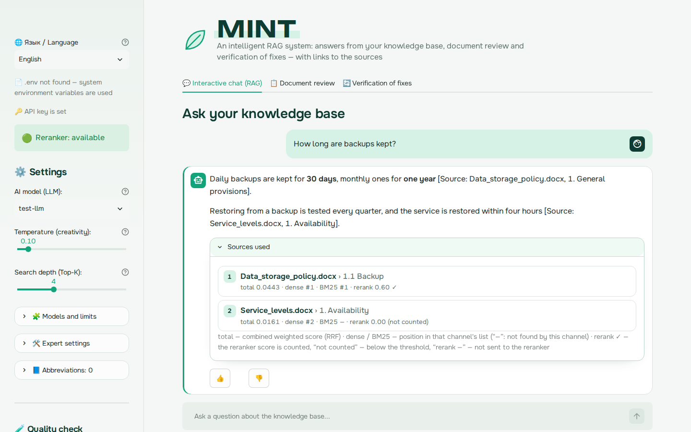
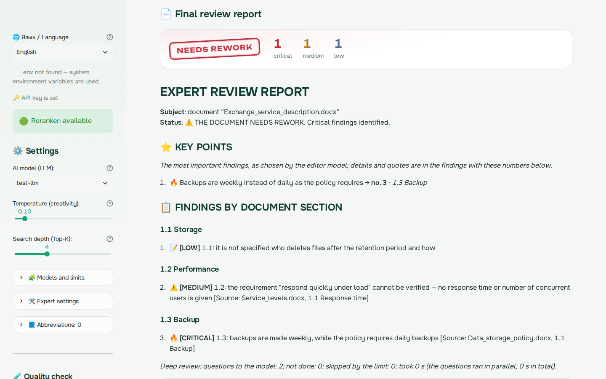
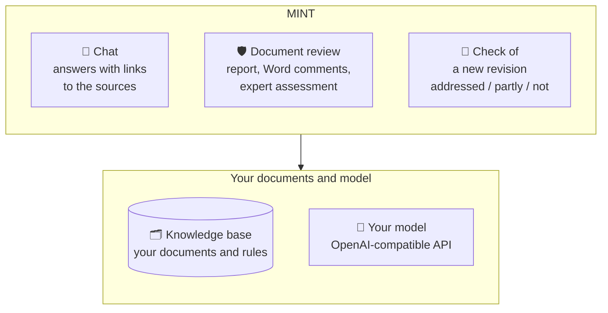

# MINT — an AI document expert that runs on your own computer

**English** · [Русский](README.ru.md)

Chat with your documents, review any document against your own rules and sources, and check that comments were
addressed in a new revision — in one application that runs on your computer, with any model you choose.

**Any documents, any knowledge base.** Contracts, policies, reports, specifications, manuals, theses — MINT does the
first pass and shows where to look, with a source for every finding. The knowledge base is whatever you load into
it: company standards, a team wiki, regulations, textbooks. MINT grew out of reviewing IT architecture documents,
and that expertise is the default profile; for other documents the general one is a click away.

**No access to frontier models? Not a problem.** MINT works with any OpenAI-compatible model — Ollama or LM Studio
on a laptop, vLLM or a corporate gateway in a company — and gets the most out of it: it splits the review into
dozens of precise questions and recomputes the figures with code, so even an open model finds substantive issues.
Your documents go nowhere except the model you configured.

## What it does

- 💬 **An intelligent chat over your documents.** Upload anything — standards, contracts, manuals, textbooks, wiki
  pages — and ask. Hybrid search (vectors + BM25 + reranker) finds the right section, answers come with links to the
  sources, follow-up questions are understood in context, and when the documents have no answer, MINT says so.
- 🧠 **Consultant: problems, diagrams, explanations.** Describe a problem, ask for a diagram or an explanation — the
  model reads in the base how your systems are built (a search by several sides of the question, whole sections,
  system cards) and proposes solution options itself, with pros, cons and risks. Facts from the documents — 📄 with
  references, the model's proposals — 💡, statements about your systems without a reference MINT marks ❔; MINT draws a
  diagram right in the answer (Mermaid, no internet access) and gives its code for draw.io and Excalidraw. Follow-ups ("and without sharding?") build on earlier answers.
- 🛡️ **Review of any document with flexible settings.** A contract, a policy, a report, a specification, a thesis —
  in .docx, .pdf, .md or .txt. MINT checks every section against your knowledge base, the documents it relies on and
  your criteria; a deep review walks through processes step by step, looks for contradictions between sections
  and recomputes the figures. Profiles (architecture and IT solutions by default, or general), your own questions to the
  document, checklists by document type, expert rules, several passes, model reasoning — all set in one block. The result: a report with "Key points" and findings by
  section, the original .docx with the findings as Word comments, and a detailed log.
- 🔄 **Check of a new revision.** Paste the comments you made and upload the revised document — MINT finds the
  relevant places and tells, for each comment, whether it was addressed, partly or not, with a quote from the new
  revision. The result comes as a table in Markdown and Word.
- ✍️ **Work with the findings.** Every review is saved: open it any day, mark the findings (✅ keep / ➖ minor /
  ❌ wrong), add your own — and download "My findings" as a Word table. The marks show which checks work best for
  your documents.
- 🎛️ **Adapts to your data.** MINT derives chunk sizes and context budgets from your model's window and collects the
  abbreviation glossary from your documents — it works on a small local model and on a large one alike.
- 🧪 **A RAG lab, not a black box.** MINT is also a constructor for learning RAG and experimenting with it: switch
  between vectors, BM25, hybrid search and the reranker, change chunk sizes, prompts and models — and measure the
  effect on your own documents: hit@k, MRR, checks of chat answers, a comparison with the previous run and a test of
  whether the difference is chance. A practical way to find out which RAG your company needs before building one.
- 🔒 **Your documents stay with you.** No cloud, no usage statistics: data goes only to the model you configure.
  Installs without administrator rights, including an offline bundle for networks without internet access —
  Windows and Linux. Interface, prompts and reports in English and Russian.

**Try it in a few minutes:** `docker compose up -d --build` starts MINT together with Ollama and open models
([docs/OLLAMA.md](docs/OLLAMA.md)); your own model or gateway is set in `.env`.

<p align="center"></p>
<p align="center"></p>

## How it works



The full diagrams — components and data flows, how search finds a fragment, how parameters are derived from your
models: [architecture](docs/MINT_architecture_preview.png) and [engineering](docs/MINT_engineering_preview.png)
(sources for [Excalidraw](https://excalidraw.com) — `docs/*.excalidraw`).

**Languages.** Switch in the sidebar or set `MINT_LANG=en` in `.env` (default: the language of your OS). Search
handles English, Russian and mixed documents: every word is reduced to its stem with an English (Porter2) or
Russian (Snowball) stemmer, and abbreviations are collected in both languages. In chat, the model answers in the
language of the question.

Every answer, review report and verification matrix has 👍/👎 buttons with an optional comment; ratings are
saved locally (`~/mint_logs/feedback.jsonl`) together with the question, answer and settings, so problems can be
reproduced.

## Quick start

Python 3.10 or newer is required. Full instructions, including Windows, Linux and offline installation, are in
[docs/INSTALL.md](docs/INSTALL.md).

```bash
git clone https://github.com/Sdorenskiy/mint.git && cd mint
./install.sh                         # Windows: install.bat — installs packages into .venv, creates .env
#   put your API addresses (LLM_API_URL, EMBED_API_URL) and key (LLM_API_KEY) into .env
.venv/bin/python check_install.py    # self-check: packages, .docx parsing, model connections, the page
./run_mint.sh                        # Windows: run_mint.bat → http://localhost:8501
```

`install.sh` / `install.bat` do not install anything system-wide: they create a `.venv` folder next to the
program, install the Python packages (Streamlit, Docling, faiss, …) of exact tested versions into it
(`requirements.lock`: about 165 MB to download, 0.6 GB on disk, no PyTorch or other model libraries), create
`.env` from the template and run the self-check. No administrator rights are needed — even without the
`python3-venv` package; to remove MINT, delete its folder. GitHub runs this installation from scratch on Ubuntu,
Debian 12 (as Astra Linux 1.8) and Windows on every change and every night. If the packages are already installed
(`pip install -r requirements.lock`), you can simply run `streamlit run app.py` from the MINT folder.

**Updating:** `./update.sh path/to/mint-<version>.zip` (Windows: `update.bat`) replaces the code and keeps your
settings, `.venv`, the knowledge base and saved reviews ([details](docs/INSTALL.md#updating)). A quick guide for
users — [docs/QUICK_GUIDE.md](docs/QUICK_GUIDE.md).

## Configuration

| File | What it holds | Required |
|---|---|---|
| `.env` | where to connect: API addresses, keys, model names, folders (template: `.env.example`) | yes |
| `config.yaml` | how to work: model limits, search, review (template: `config.example.yaml`) | no |
| `glossary.json` | your own abbreviation expansions (template: `glossary.example.json`) | no |
| `checklists.yaml` | your own review checklists by document type — written by the review tab (template: `checklists.example.yaml`; another location: `MINT_CHECKLISTS` in `.env`) | no |
| `mint/prompts/en.yaml`, `ru.yaml` | default prompt texts for the models, one key per text (the general profile; `profiles/` — the texts other profiles replace); the version of the set (a hash) is recorded with every rating, review log and quality check | already set |
| `prompts.yaml` | your own edits of the prompts — written by the "📝 Prompts" page, only the texts you changed (another location: `PROMPTS_PATH` in `.env`) | no |
| `.streamlit/config.toml` | Streamlit: localhost only, no usage statistics, MINT colours, fonts from `static/` | already set |
| `MINT_LANG` in `.env` | interface language: `en` or `ru` (default: the OS language) | no |
| sidebar | changes for the current session | — |

### Model limits and derived parameters

Models differ: an LLM context window may be 4K tokens or 128K, an embedding model may accept 512 or 8192
tokens. MINT takes the limits from the server (if it reports them), from `config.yaml` or from the sidebar, and
derives chunk sizes and context budgets for chat, review and the reranker. Each derived value is the smaller of
the default and the model's ceiling: a large window does not inflate chunks (long context adds noise, not
accuracy), a small window shrinks them so requests are never truncated. Any derived value can be pinned
manually — in the sidebar for the session or in `config.yaml` permanently.

The "Detect from server" button asks the server for the model windows and measures how many characters of text
make one token, in the language of the knowledge base: on Russian text for a Russian base, on English text for
an English one, and on both for a mixed or empty base, taking the lower value.

If the server does not report the model window (common behind a gateway), the label says "typical value" —
32768 tokens. That is not the real window: set it in "Models and limits" (for the selected model, for the
session) or in `config.yaml` (`llm_context_tokens`). The window decides whether the model sees the whole
document during a review.

### Slow answers and timeouts

If the model does not answer within "LLM response timeout" (90 s by default, Expert settings → Language model),
the request fails; in a document review that section is not checked. MINT then:

- checks such sections again at the end of the review, with a longer timeout (twice the setting, at least 180 s),
  if the failure was a timeout, a busy gateway or the network and at least one section did get checked (if none
  did, the gateway is probably down and a retry would only double the wait);
- offers "🔁 Recheck unchecked sections" under the report — only those sections, the findings are added to it;
- shows in the review log how long each section took.

In a review MINT receives answers as a stream (`llm_stream`) and cuts off an answer that goes far beyond the
"Max answer length" — the gateway may ignore it — or loops (the model repeats the same lines). A gateway without
streaming gets an ordinary request. Sections and deep review questions run in parallel (`audit_parallel`, 3 by
default); the log shows the wall-clock review time and the sum over sections.

The usual causes are a busy gateway or a model that reasons before answering (thousands of hidden tokens).
"Turn off model reasoning" (Expert settings, `llm_no_reasoning` in `config.yaml`, `LLM_NO_REASONING=1` in
`.env`) sends the standard switch-off parameter that vLLM and SGLang understand, regardless of the model; a
gateway that does not know it gets the request without it. MINT notices a reasoning model by its answers and
says so in the sidebar and in the timeout message. Anything else your gateway needs goes into
`llm_extra_body` / `LLM_EXTRA_BODY` — a JSON object added to every request to the LLM.

### Abbreviation glossary

Abbreviations are collected automatically from uploaded documents (lists of abbreviations, tables,
"Full Form (ABBR)" patterns). Search then finds a document by either form, and the model receives a reference
list to expand abbreviations in answers. Your own `glossary.json` is only needed for corrections: fix an
expansion, add a missing one, or remove a wrong one with an empty value (`"ABC": ""`).

### Knowledge base

Stored in `KB_DIR` (default `~/knowledge_base`). For every document MINT records which embedding model and
chunking parameters were used and keeps the original file in `sources/`; if you change the embedding model or
chunking, MINT marks the affected documents and offers re-indexing. `python kb_stats.py` shows per-document
statistics and can compare two bases.

### Document formats

| Format | How it is read | Headings (sections in references) |
|---|---|---|
| .docx | Docling's Word backend — no models, no PyTorch | Word heading styles ("Heading 1–3") |
| .pdf | from the text layer (pdfplumber), **without models**: nothing to download, nothing is sent anywhere | in this order: PDF bookmarks → the "Contents" page with dot leaders → slide titles → font size and weight |
| .md | MINT itself | `#` headings, pipe tables |
| .txt | MINT itself (UTF-8, UTF-16 or Windows-1251) | numbered lines ("2.1 …") and lines in CAPITALS |

For a PDF, MINT also removes running headers and footers, page numbers, the ESKD frame and stamp, and the
contents pages, and turns ruled tables into Markdown. The upload message says where the structure came from. A
PDF without a text layer (a scan) or with damaged fonts ("Print to PDF" sometimes stores letters under the
wrong codes) is not indexed: MINT explains why and suggests the .docx or a PDF saved from Word. Text in images
is not read in any format. The document review adds Word comments only to a .docx; other formats get the
report and the log.

### Consultant

The "🧠 Consultant" tab is for advice rather than for "what the document says": analyse a problem and propose
options, draw a diagram, explain how a system is built, compare approaches. The model learns from the base how your
systems are built and proposes solutions itself.

1. **Request analysis** (+1 LLM call): what is asked (a problem, a diagram, an explanation, a question, a
   comparison), which systems are mentioned, and several search queries — one for each side of the question.
2. **Context**: a search for every query and for the user's request itself (the usual MINT hybrid search); the
   results alternate between the queries, a found fragment is extended to its whole section with subsections (a
   section longer than `consult_section_max_chars` gives a window around the found place), the cards of the systems
   mentioned are always added. The amount follows the model window, at most `consult_context_max_chars`.
3. **Answer**: "📄 How it works now" — only from the documents, with references; 💡 — the model's proposals and
   knowledge; for a problem — causes, 2–4 options (pros, cons, risks, effort) and a recommendation; for a diagram —
   a Mermaid diagram (MINT draws it in the answer) and the steps with references; at the end — what is not in the base and what to clarify.
4. **Checks without a model**: references — against all fragments the model saw in the conversation; items of the
   📄 section without a reference are marked ❔; the diagram code can be downloaded (.mmd, opens in draw.io and
   Excalidraw).

The consultant has a conversation of its own: earlier answers are part of the work and follow-ups build on them (the
chat needs its history only to understand the question). Settings — "⚙️ Consultant settings" in the tab or the
`consult` section of `config.yaml`. Texts — "📝 Prompts", the "Consultant" group; they have a version of their own
(`en-consult-…`), the chat and review prompt version does not depend on them. Limits: the quality of the options
depends on the model; if the base describes your systems sparingly, the answer is generic — MINT shows this in
"🔎 What was found in the wiki" and in the "not in the base" section. Streamlit draws the diagram (part of Streamlit,
no internet access); the layout is automatic — refine the diagram in draw.io or Excalidraw from the .mmd code.

## Document review

1. The document is split into parts **by section**: a heading with its text and tables. Small neighbouring
   sections are combined; a section up to one and a half times the part limit (`audit_map_size`) is not split, so
   a process table stays whole with its heading; a large table is split by rows with the header repeated and a
   "continued" note. Tables from Docling are compacted (no padding) — the document becomes half as long.
2. Each part is reviewed with the norms from the base, the basis documents (see below) and **the whole document for
   reference** if it fits into the model's window: the model sees the links between sections and does not write "not
   described" about what is in another section. If it does not fit, the model gets the outline, and "not described"
   findings are checked against the most similar sections. The model walks through a described process step by step:
   who does what, what is passed to whom, whether there is a gap, whether the recipient can process the data. Then
   the self-check runs.
3. Each **"special attention"** point (separated by ";", new lines or questions) is answered once from the whole
   document: an "Answer:" line and findings. The report has a separate block before the list of findings. The
   answers come after the other checks and get their findings: the answer agrees with them, and only new findings
   are written. The model answers "no problem" only with a verbatim quote from the document; if the document does
   not say so, the answer is "not clear from the document" and what is not described.
4. **Without the model** MINT checks abbreviations (used without a definition; defined but unused) and the
   references and figures in findings: a table, clause, act or figure found neither in the document nor in the
   norms moves the finding to the "Not confirmed by a source — please check" block.
5. **Deep review** (a checkbox on the tab, `audit_deep`): instead of one big request "review the section", the
   model answers many narrow questions that a medium-sized model handles reliably:
   - process: each pair of neighbouring steps (where the input comes from, who passes it on, whether the
     recipient can read the data), each process requirement (is there a step, no contradiction), the process
     boundaries. MINT finds the steps in a table of operations, in a list of steps (numbered, "Step 1. …", or a
     bulleted list after a lead-in such as "The exchange goes as follows:") and in "Step N" subsections; the log
     header shows which descriptions of a process it found;
   - contradictions: the model lists statements from the parts with a topic from a list, and statements on one
     topic are compared;
   - figures: the program lists and recalculates the indicators (per day × 365 against per year), the model judges;
   - typos — in each part.

   Without the model — formatting: a clause as plain text instead of a heading, the contents against the headings,
   empty tables, columns, fields and cells of the table of operations. Dozens of questions (at most
   `audit_deep_max_calls`), `audit_parallel` at a time.

   **Several passes** (`audit_passes`, 1–3): the section check and the questions about the process, requirements,
   figures and contradictions are repeated with temperature at least 0.4, and the findings of the passes are
   merged — what the model missed by chance in one pass, another finds, and what is found several times ranks
   higher in the report. **Review with reasoning** (`audit_reasoning`): the model reasons before every review
   answer (in the chat — as configured); 6000 tokens are added to the answer length, the timeout is at least
   300 s. Both are for measuring against a reference: slower, but possibly more accurate.
6. Duplicates are merged: first by words, then by the model (+1 call, `audit_merge_duplicates`; a long list — in
   batches). Each finding shows its section of the document (by the clause at its start, the quote or the words); a
   merged one shows every section where it appeared. Identical lines within an answer are dropped. A long section
   (a table of dozens of rows) is reviewed in pieces, and the model writes about one gap in every piece in its own
   words — such findings are merged without the model at a lower word overlap (`RUN_DUP_SIMILARITY`; the log shows
   how many). A section check
   asks for at most 10 significant findings and takes at most 12 (critical first); a finding about a clause of
   another part of the document ("2.2.3, step 4: …" while checking section 1) is dropped — its own part checks
   it. The self-check runs in batches of 15.
7. A finding based on a norm from the base ends with a [Source: file, section] reference; a reference to a file
   the model did not receive moves the finding to "Not confirmed by a source".
8. The report lists the main findings by document section, in document order (findings without a section — "The
   document as a whole"); minor and general ones (low, without a quote or a place in the document) and typos come
   in separate blocks at the end. There are no topics such as "security" or "SLA": grouping by section suits a
   document of any type.
9. The report starts with **"Key points"** (`audit_summary_max`, 12 by default; 0 — no block): an editor model
   picks the most important findings and writes the gist of each in one line with the number of the finding below.
   It is a pointer, not a copy: the number of findings does not change. If the model does not answer, the findings
   found by several checks and critical ones are taken.

All review settings are on the "Document review" tab, block **"⚙️ Review settings"**: knowledge base, deep review,
self-critique, passes, reasoning, "Key points", context sizes. Values apply for the session; permanent ones are in
`config.yaml` (section `audit`).

**Profile** (sidebar → "🧭 Profile"; the default is `profile` in `config.yaml`) is the set of prompts for chat, review
and verification of fixes. **Architecture and IT solutions** (the default): the roles of an architecture board; the
criteria are requirements, compliance with the target architecture, the system's target indicators, data
processing and protection, architectural risks. **General — any documents**: neutral roles; the review criteria are
requirements and obligations, completeness, consistency with the basis documents and the norms of the base, figures,
dates, terms and references, hidden risks. The profile fills the "General review criteria" field — edit it for a particular
document right there; the profile texts are on the "📝 Prompts" page.

#### Expert knowledge: checklists, rules, system cards

A document does not know what an expert knows: what to check in a document of this type, which rules the
organisation follows, what the systems the document relies on can do. MINT adds this in three ways; everything you
set up stays with you (your own files are outside git) and is not overwritten by MINT updates.

**Checklist by document type** ("📋 Checklist" on the review tab). MINT recognises the document type by words in
the file name and at the start of the document (the title page) — each type has its own list of words; the type
can also be chosen by hand. Each item is a separate question to the model over the whole document: the answer
"yes / partially / no / not applicable" and findings; the report has a "Checklist" block. Items can be edited for
this run or saved with the "💾" button to `checklists.yaml`, where new types and recognition words go too. Until
you have your own file, the example `checklists.example.yaml` (`checklists.example.en.yaml` in the English
interface) is used. Write an item so that the answer can be found in the text: "For each role it is described what
it does in the system", not "Are all roles covered".

**Expert rules** — a knowledge base document marked "📌 Always use in the review" (sidebar → "For the review:
expert rules and system cards"). Ordinary documents are found by searching for each section, at most
`audit_context_max_chars`; the model gets the rules in every check on top of that limit — in full, or, if they do
not fit (`audit_pinned_max_chars`), the fragments closest to the text under review. Search returns fragments, so
each rule must be clear on its own:

```
### ENC-03. Encryption — for the recipient's certificate
When it applies: data is passed in encrypted form at some step.
Rule: Participant A encrypts the data for the certificate of participant B, who will decrypt it. For each step
where a participant receives encrypted data, it is stated whose certificate it is encrypted for and who decrypts it
and where.
Typical mistake: the recipient "accepts" data encrypted for someone else's certificate — it cannot read it.
Grounds: a document or decision, if any.
```

**System cards** — knowledge base documents marked "🗂️ System cards": what the system can do now, what is planned
and by when, its limitations, how other systems connect to it. A card is added to the check of a section where the
system is mentioned; for each system mentioned in the document at least twice (up to 5 systems, `audit_systems`),
the model lists what the document requires from it with the statuses "available / planned / change needed /
conflict / unclear" — the "What the document requires from systems" block of the report. MINT recognises the
system by the "Names:" line at the start of the card and by its heading (Russian word endings are allowed;
abbreviations — as written):

```
# System card "System A"

Names: System A, SA

As of: 10.2026

## What it can do now
## What is planned and by when
## Limitations (what it cannot do)
## How other systems connect to it
```

The most valuable part of a card is the limitations and the plans with dates: official documentation usually lacks
them. An outdated card leads to wrong conclusions — update it after releases.

**MINT puts a draft card together** (sidebar → "📌 For the review: expert rules and system cards" → "🗂️ Draft a
system card from the base"). Load the system's documentation and wiki pages into the base first, then enter the
system name. MINT asks the base one narrow question per card section (names, purpose, services, limits, data
protection, storage, plans, limitations, connection, requirements for neighbours) and writes only what it finds into
the draft — each fact with a [Source: …] reference; a fact whose reference is not among the fragments found is marked
"check", a section with nothing found — "not in the base". The draft downloads as .md: an expert checks the facts
against the sources, adds limitations and plans, removes the "draft" note and loads the card into the base (or the
wiki) marked "🗂️ System cards". The prompt — "📝 Prompts" → "System cards".

**Basis documents** (`audit_basis_docs`, the "📎 Basis documents" block on the tab after the document is uploaded).
Norms for a section are searched by the text of the section itself — and find similar places in other documents,
while a requirement that concerns the whole document (where the data goes, through which subsystem) is worded
differently in the section. But a document names its basis itself: on the title page ("developed in accordance with
… Technical specification for development (code)") and in the "Referenced documents" section. MINT looks these
documents up in the base — by the code at the start of a base document (a document that only refers to that code
does not count) or by title (again without the base document's own references: a guide developed under the same
specification is not taken for the specification) — and adds their fragments closest to the section in words and
in meaning (the base's vectors; at most `audit_basis_max_chars`, an equal share for each basis document, no
abbreviation, term or contents sections) to every section check and to the answers to items, as a separate block:
"the document must comply with them". The block on the tab shows what was found and by which reference and which
documents are not in the base; an extra document can be removed, a missing one added. The log has a "Basis
documents" line: how each was found, what was added and what was removed by hand. A document marked 📌 or 🗂️ is not
added here: it is in every check anyway.

**Whole document in one request** (a checkbox on the tab) — for comparison: the model gets the whole document and
writes all findings in one answer (up to 4000 tokens, a timeout of at least 300 s). Faster and without duplicates;
medium-sized models usually find fewer specific findings this way — check with a comparison against a reference.

**Comparison with a reference** (below the report): enter the findings the review should find (an expert's, a
previous approval's), and the model marks which were found, partly or not, and shows how many findings the
report has and how many of them match the reference. Run the same document with another
model or settings and compare again: this shows which model finds what.

Parts and answers the model did not return (timeout, gateway failure) are checked again — see "Slow answers and
timeouts".

#### Saved reviews and expert assessment of findings

Every review is saved on the user's computer, in `LOG_DIR/audits/`: the report, the log, raw model answers
(compressed), a copy of the reviewed .docx. **"📂 Saved reviews"** at the top of the tab lists them: open a review
(no need to upload the document; re-checking is only for a review of the current session) or delete it.

**"✍️ Expert assessment of findings"** is below the report. The expert marks every finding: ✅ keep — the finding
is correct; ➖ minor — correct but not significant; ❌ wrong — with a reason from a list (the document has it; the
model misread the text; not relevant to the document; common practice, not an error; duplicates another finding;
other). Each finding shows which check found it, whether it is in "Key points", whether it refers to a basis
document, how many checks found it, and the quote. Below is a table for your own findings that MINT missed. Marks
are saved at once, so the assessment can go on another day; a mark is tied to the finding's text, so re-checking
failed sections does not shift it.

The result is **"My findings"**: those marked ✅ (optionally ➖ too) and your own — as Word (a table: No., section,
finding, severity), Markdown, or Word comments in the reviewed document itself.

**Assessment for improving MINT.** The marks are also quality data: which checks are wrong and why, what MINT misses.
"📤 Download the assessment (.json)" — one review; "📥 Download the assessments (.jsonl)" in "📂 Saved reviews" —
every review with marks. By default with finding texts (this shows what exactly is wrong); "Without finding texts"
keeps check kinds, severity, marks and reasons — no texts, quotes, sections, comments or file names. A summary over
many files:

```bash
python tools/review_stats.py folder_with_assessments > summary.md
```

— the share of correct findings by check kind, report block, severity, "Key points", basis documents and model;
reasons for "wrong"; how many findings experts added themselves; text examples (`--examples 0` — none). The output
is in Russian. A guide for users — [docs/QUICK_GUIDE.md](docs/QUICK_GUIDE.md).

## Quality check: search and answers

**In the interface:** sidebar → "Quality check". Three steps, no files to prepare:

1. **Questions.** MINT writes questions from fragments of your base (in the fragment's language, one model
   call each) or takes the questions of the last check. You edit them in a table, add your own rows and mark
   the ones the base cannot answer. Before the run MINT flags labels that can never be counted (the phrase or
   section is not in the document) and shows the fragment each question was written from.
2. **Run.** Every question goes through MINT's search in several configurations (vectors only, BM25 only,
   hybrid, hybrid + reranker with different weights); optionally the chat answers every question too — the same
   pipeline as the Chat tab, 1–3 times ("How many times to ask each question in chat": the model does not always
   answer the same way).
3. **Results.** Where the correct fragment ended up (hit@1, hit@K, MRR), false alarms of the "low confidence"
   signal, changes since the last check, configurations compared question by question with a sign test
   (could the difference be chance?), what to change — applied to the session with one button, with a
   `config.yaml` snippet to keep it — and the questions search gets wrong. Every check is saved to
   `LOG_DIR/eval/<date_time>` (report.md, details.csv, questions.csv, summary.json, answers.csv).

**Chat answers** are checked without a second "judge" model: does the answer cite the right document, does it
cite fragments the model never received, did the model wrongly say "no information", did it honestly say so for
questions the base cannot answer (the `chat_no_info` phrase of the prompt). Each failure is attributed to
**search** (the right fragment was not in the context — tune search) or to the **model** (it was, but the
answer is wrong — change the chat prompt or the model). The results record the prompt version, language and
model; a check with answers is compared with the previous one question by question, with a sign test and a
list of what changed in the settings. This is how a prompt change is measured: a check before, the change on the
"📝 Prompts" page (the version changes; see below), a check after. The checks look at the form of an answer;
whether it is right in substance you read in the per-question table and in answers.csv, which holds every
answer in full.

**From the console** — the same core (`mint/evaluation.py`):

```bash
python eval_search.py --generate 40 --out eval/questions.csv   # draft questions from your base (review them!)
python eval_search.py eval/questions.csv                        # evaluate → eval_results/<date>/report.md
python eval_search.py eval/questions.csv --compare eval_results/<previous run>/summary.json
python eval_search.py eval/questions.csv --answers --repeat 3 --quick   # chat answers (after a prompt change)
```

Labels refer to the file name, section and a verbatim phrase rather than internal IDs, so a question set
survives re-indexing. The format is shown in `eval/questions.example.csv`. Questions written by the model share
words with their fragment and flatter keyword search: reword them the way people ask and add real questions.

## Prompts: editing and measuring

Sidebar → "📝 Prompts": the texts MINT sends to the models — chat, follow-up question rewrite, paraphrase,
section review, self-critique, fix verification, draft questions. Each comes with what it does and what must
stay in it; the text is edited in the interface language.

- **Try in this session** — the edit applies only in this browser window (chat, review and the quality check
  use it) until the window is closed;
- **Save** — writes the edit to `prompts.yaml` next to the program: it applies to everyone and survives a
  restart. Only the texts you changed are stored; the rest keep coming from `mint/prompts/<lang>.yaml`, so MINT
  updates still reach them. If a default text changes after you saved your edit, the page warns you and shows
  the difference;
- **Return to default** — removes the edit from the session and from `prompts.yaml`;
- **Check the edit** — applies the edit in the session and opens the quality check with chat answers on the
  questions of the previous check (each asked twice); the result is compared with the previous answer check
  question by question.

The answer format the code parses (`[Source: …]` references, severity tags, the JSON fields of self-critique and
fix verification) and the `{{…}}` placeholders cannot be removed: such an edit is not applied, and the page says
what is missing. The markup MINT builds itself (context and source headers) is shown but not edited. The
prompt-set version includes your edits and is recorded with every rating, review log and quality check, along
with which prompts were edited (`prompts_custom`). Review, fix verification and draft questions are not measured
by the chat answer check: test an edit there on a document with known remarks.

## Testing

All tests in `tests/` are automated and need neither network nor models: the LLM gateway is simulated and test
documents are generated on the fly. Run them with `python tests/run_all.py` (about 10 seconds). GitHub Actions
runs them on every push and pull request on Linux (Python 3.10–3.12) and Windows.

| Kind | What it checks | Where |
|---|---|---|
| **Unit** | single functions: stemmers, abbreviation extraction, `.env` parsing in different encodings, derived parameters, connection error hints, FAISS index format, completeness of the English translation; prompts: the same keys, placeholders and rules in both languages, the answer format the code parses, which edits are applied and which are not; every regular expression on awkward text (long words, thousands of dots or spaces) — no hangs | `test_app.py` sections marked `[unit]`; `test_env.py`; `test_i18n.py`; `test_prompts.py`; `test_regex_speed.py` |
| **Integration** | several modules with the simulated gateway: .docx, .pdf, .md, .txt → knowledge base → search → answer; document review; saved reviews and expert assessment; fix verification; search evaluation; self-check; update in place | `test_app.py` sections `[интеграция]`; `test_formats.py`; `test_eval.py`; `test_check_install.py`; `test_expert_review.py`; `test_update.py` |
| **End-to-end** | user actions on the page: buttons, uploads, tabs, feedback, prompt editing — in Russian and English (with a Streamlit stub) | `test_app.py` section `[сквозной]`; `test_i18n.py` |
| **Smoke** | the page on real Streamlit: it opens, chat answers, buttons work, a saved review opens and its findings are marked | `test_streamlit_smoke.py` (GitHub Actions) |
| **Installation** | a fresh install as a user does it: `install.sh` / `install.bat` on a clean machine (Ubuntu with Python 3.10–3.12, Debian 12 without `python3-venv`, Windows), then the real Docling, base → chat → review and the self-check; on every change and every night. Plus .docx parsing compared with the full Docling on Docling's test documents | `test_real_install.py` (`.github/workflows/install.yml`); `tools/docx_parity.py` (`docx-parity.yml`) |
| **Installation smoke** | a specific computer: Python, packages, real Docling, your `.env` and gateway, the page | `check_install.py` (run manually) |
| **Docs** | the diagrams in `docs/` match their build scripts, every function and parameter they name exists, the parameter table matches the code | `test_diagrams.py` |

Tests do not measure answer or review quality on real documents — use the quality check, a manual check on
already-reviewed documents, and the 👍/👎 feedback for that.

## Project layout

```
app.py              Streamlit entry point (streamlit run app.py)
mint/               the program; everything except mint/ui works without Streamlit
  config.py           settings: .env, config.yaml, defaults
  services.py         HTTP calls: LLM, embeddings, reranker; TLS
  limits.py           model windows → chunk sizes and context budgets
  parsing.py          document parsing by format: .docx (Docling), .md, .txt; Markdown for review
  pdfparse.py         .pdf without models: text layer, headings from bookmarks / contents page / font
  kb.py               knowledge base: indexing, removal, re-indexing, manifest
  bm25.py, stemmer.py keyword search with Russian morphology
  glossary.py         abbreviations
  search.py           hybrid parent/child search: vectors + BM25 + reranker (RRF)
  passages.py         context assembly: adjacent fragments joined, long ones cut around the match
  citations.py        checks the [Source: file, section] references in chat answers
  audit.py            document review: run_audit() — sections, self-critique, answers to items, report, Word comments
  sections.py         review: parts of the document by section; parallel.py — parallel requests to the model
  deep_checks.py      deep review: narrow questions on the process, contradictions, figures, typos; formatting
  expert.py           expert knowledge: checklists by document type, "always use" rules, system cards
  cards.py            a system card draft from the knowledge base: draft_system_card()
  expert_review.py    expert assessment of findings: rows, "My findings" (Word, Markdown), the assessment file;
                      review_labels.py — its codes and labels
  audit_store.py      saved reviews: the LOG_DIR/audits/<id> folder, list, open, delete
  review.py           verification of fixes: verify_remarks()
  chat.py             chat: answer_question() — search → model → reference check; follow-up questions
  consult.py          consultant: answer_consult() — request analysis → search by sides, whole sections →
                      model → reference and unreferenced-item checks, diagram code
  prompts/            default prompt texts: en.yaml, ru.yaml, profiles/; assembly, your edits (prompts.yaml), their checks
                      and prompts_version() — __init__.py
  evaluation.py       quality check: questions from the base, search run, metrics, recommendations, chat answers
  i18n/               interface languages: tr() and English translations (en.py)
  feedback.py         👍/👎 feedback
  ui/                 Streamlit interface: page, sidebar, four tabs, expert assessment (ui/audit_review.py),
                      quality check (ui/quality.py),
                      prompts (ui/prompts_page.py), system card draft (ui/cards_page.py);
                      theme — ui/theme.py, ui/assets/mint.css
check_install.py    installation self-check
eval_search.py      quality check from the console
kb_stats.py         knowledge base statistics
install.sh/.bat     install into .venv;  run_mint.sh/.bat — start;  update.sh/.bat — update in place
tests/              automated tests (python tests/run_all.py)
tools/diagrams/     build scripts for the diagrams in docs/ and docs/ru/
tools/review_stats.py  summary of expert assessments ("📤 Download the assessment" files)
tools/docx_parity.py   is .docx parsed the same way by Docling's Word backend and by the full Docling
tools/ui_preview/   README screenshots on real Streamlit with neutral demo data (GitHub Actions → ui-preview-<branch>)
static/fonts/       interface fonts (OFL), served locally
docs/               installation, Ollama, security, screenshots (img/); docs/ru — Russian versions
```

## Documentation

- [docs/QUICK_GUIDE.md](docs/QUICK_GUIDE.md) — a guide for users: review, assessing findings, handing over
  assessments, updating
- [docs/INSTALL.md](docs/INSTALL.md) — installation on Linux and Windows, offline bundle, troubleshooting
- [docs/OLLAMA.md](docs/OLLAMA.md) — trying MINT with open models
- [docs/SECURITY.md](docs/SECURITY.md) — data flows, what is stored where, risks, deployment notes
- Diagrams (open in [Excalidraw](https://excalidraw.com) or Obsidian):
  - [architecture](docs/MINT_architecture_preview.png) — components, data flows, how search finds a fragment
    (`docs/MINT_architecture.excalidraw`);
  - [engineering](docs/MINT_engineering_preview.png) — how parameters are derived, the model window budget,
    the parameter reference, tuning steps and internals (`docs/MINT_engineering.excalidraw`).
- [CHANGELOG.md](CHANGELOG.md) — version history
- [CONTRIBUTING.md](CONTRIBUTING.md) — how to contribute
- [docs/ru/](docs/ru/) — all of the above in Russian, plus a draft for an information-security approval

## Roadmap

1. Multi-user deployment on a shared server: authentication via a reverse proxy, separate knowledge bases.
2. Scanned PDFs (text recognition) — if a recognition model is available in your network.
3. English output for `kb_stats.py` (currently Russian).

Feedback and pull requests are welcome.

## License

MIT — see [LICENSE](LICENSE).
