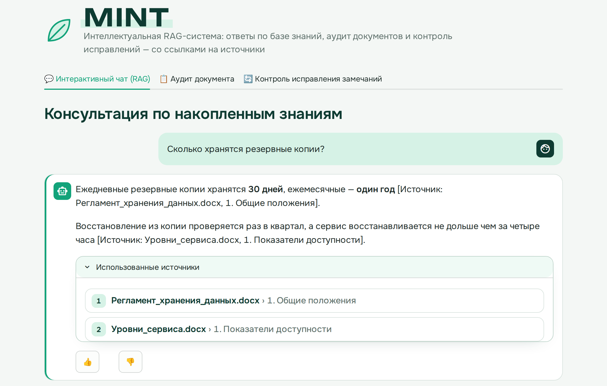
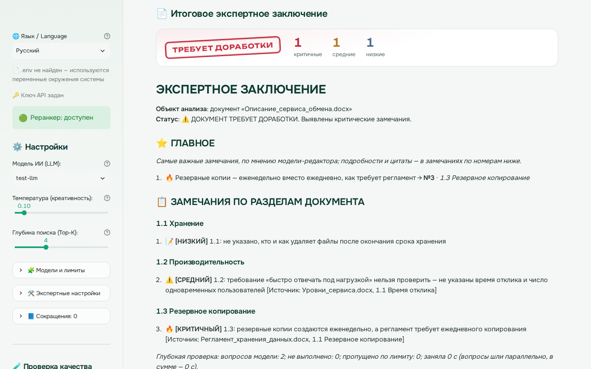
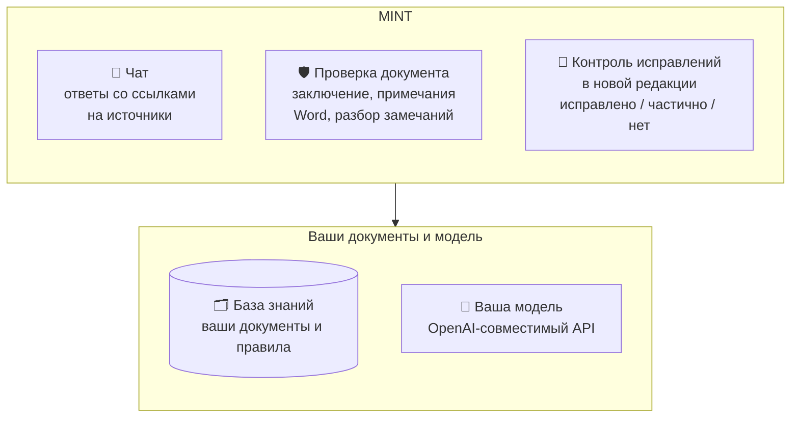

# MINT — ИИ-эксперт по документам, который работает у вас

**Русский** · [English](README.md)

Чат по вашим документам, проверка любого документа по вашим правилам и источникам и контроль исправления
замечаний в новой редакции — в одном приложении на вашем компьютере, с любой моделью, которую вы выберете.

**Любые документы, любая база знаний.** Договоры, положения, отчёты, технические задания, инструкции, курсовые —
MINT делает первый проход и показывает, куда смотреть: у каждого замечания — источник. База знаний — то, что вы в неё
загрузите: стандарты компании, вики команды, нормативные документы, учебники. MINT вырос из проверки архитектурной
документации, и этот опыт — профиль по умолчанию; для других документов универсальный профиль — в один клик.

**Нет доступа к фронтирным моделям? Не проблема.** MINT работает с любой OpenAI-совместимой моделью — Ollama или
LM Studio на ноутбуке, vLLM или корпоративный шлюз в компании — и выжимает из неё максимум: проверку разбивает на
десятки точных вопросов, а цифры пересчитывает кодом, поэтому замечания по существу находит и открытая модель.
Документы никуда не уходят, кроме выбранной вами модели.

## Что умеет

- 💬 **Интеллектуальный чат по вашим документам.** Загрузите что угодно — стандарты, договоры, инструкции, учебники,
  страницы вики — и спрашивайте. Гибридный поиск (векторы + BM25 + реранкер) находит нужный раздел, ответ приходит со
  ссылками на источники, уточняющие вопросы понимаются в контексте диалога, а если ответа в документах нет — MINT
  так и скажет.
- 🛡️ **Проверка любого документа с гибкой настройкой.** Договор, положение, отчёт, техническое задание, курсовая —
  в .docx, .pdf, .md или .txt. MINT проверяет каждый раздел по вашей базе знаний, по документам, на которые он
  опирается, и по вашим критериям; глубокая проверка проходит процессы по шагам, ищет противоречия между разделами и
  пересчитывает цифры. Профили («Архитектура и ИТ-решения» по умолчанию или универсальный), ваши вопросы к документу,
  чек-листы по типам документов, правила экспертов, несколько проходов, рассуждения модели — всё настраивается в
  одном блоке. Результат — заключение с блоком «Главное» и
  замечаниями по разделам, исходный .docx с замечаниями примечаниями Word и подробный лог.
- 🔄 **Контроль исправлений в новой редакции.** Вставьте свои замечания и загрузите исправленный документ — MINT
  найдёт нужные места и по каждому замечанию скажет: исправлено, частично или нет, с цитатой из новой редакции.
  Результат — таблица в Markdown и Word.
- ✍️ **Работа с замечаниями.** Каждая проверка сохраняется: откройте её в любой день, отметьте замечания (✅ беру /
  ➖ мелочь / ❌ неверно), допишите свои — и скачайте «Мои замечания» таблицей Word. По отметкам видно, какие
  проверки лучше всего работают на ваших документах.
- 🎛️ **Подстраивается под ваши данные.** Размеры фрагментов и объём контекста MINT рассчитывает по окну вашей
  модели, словарь сокращений собирает из документов — работает и с небольшой локальной моделью, и с большой.
- 🧪 **Лаборатория RAG, а не чёрный ящик.** MINT — ещё и конструктор для изучения RAG и экспериментов с ним:
  переключайте векторы, BM25, гибридный поиск и реранкер, меняйте размеры фрагментов, промпты и модели — и измеряйте
  результат на своих документах: hit@k, MRR, проверка ответов чата, сравнение с прошлым прогоном и проверка, не
  случайна ли разница. Практичный способ понять, какой RAG нужен вашей компании, ещё до того, как его строить.
- 🔒 **Документы остаются у вас.** Без облака и без сбора статистики: данные уходят только в модель, которую вы
  указали. Ставится без прав администратора, есть офлайн-комплект для сети без интернета — Windows и Linux (в том
  числе Astra Linux). Интерфейс, промпты и отчёты — на русском и английском.

**Попробовать за несколько минут:** `docker compose up -d --build` запускает MINT вместе с Ollama и открытыми
моделями ([docs/ru/OLLAMA.md](docs/ru/OLLAMA.md)), а свою модель или шлюз можно подключить в `.env`.

<p align="center"></p>
<p align="center"></p>

## Как устроен



Подробные схемы — компоненты и потоки данных, как поиск находит фрагмент, как параметры рассчитываются по вашим
моделям: [архитектурная](docs/ru/MINT_architecture_preview.png) и [инженерная](docs/ru/MINT_engineering_preview.png)
(исходники для [Excalidraw](https://excalidraw.com) — `docs/ru/*.excalidraw`).

**Языки.** Переключатель в боковой панели или `MINT_LANG=en` в `.env` (по умолчанию — язык системы). Поиск
работает с русскими, английскими и смешанными документами: каждое слово приводится к основе русским (Snowball) или
английским (Porter2) стеммером, сокращения собираются на обоих языках. В чате модель отвечает на языке вопроса.

## Быстрый старт

Нужен Python 3.10 или новее. Подробно, в том числе для Astra Linux, Windows и установки без интернета, —
в [docs/ru/INSTALL.md](docs/ru/INSTALL.md).

```bash
./install.sh                         # Windows: install.bat — ставит пакеты в .venv, создаёт .env
#   впишите в .env адреса API (LLM_API_URL, EMBED_API_URL) и ключ (LLM_API_KEY)
.venv/bin/python check_install.py    # самопроверка: пакеты, разбор .docx, связь с моделями
./run_mint.sh                        # Windows: run_mint.bat → http://localhost:8501
```

`install.sh` / `install.bat` — это не установка в систему, а подготовка папки MINT: скрипт создаёт рядом с
программой папку `.venv` и ставит в неё нужные пакеты Python (Streamlit, Docling, faiss и др.) точных проверенных
версий (`requirements.lock`: ≈ 165 МБ скачивания, ≈ 0,6 ГБ на диске, без PyTorch и других библиотек моделей),
создаёт `.env` из образца и запускает самопроверку. Права администратора не нужны — даже без пакета
`python3-venv`; система не меняется; удалить MINT — удалить папку. Такую установку с нуля GitHub проверяет на
Ubuntu, Debian 12 (как Astra Linux 1.8) и Windows при каждом изменении и каждую ночь. Если пакеты у вас уже стоят
(`pip install -r requirements.lock`), скрипт не нужен — запускайте сразу: `streamlit run app.py`. Подробнее — в [docs/ru/INSTALL.md](docs/ru/INSTALL.md#зачем-installsh-и-run_mintsh).

**Обновление:** `./update.sh путь/к/mint-<версия>.zip` (Windows: `update.bat`) — код заменяется, свои настройки,
`.venv`, база и аудиты остаются ([подробнее](docs/ru/INSTALL.md#обновление)). Памятка для пользователей —
[docs/ru/QUICK_GUIDE.md](docs/ru/QUICK_GUIDE.md).


## Отзывы

Под каждым ответом, заключением аудита и матрицей контроля есть кнопки 👍/👎 и поле для комментария.
Оценки записываются в `~/mint_logs/feedback.jsonl` вместе с вопросом, ответом, источниками и настройками.
Этого хватает, чтобы воспроизвести случай. Файл можно скачать в боковой панели («💬 Отзывы») и переслать
разработчику.

> В файле отзывов есть цитаты из ваших документов — пересылайте его только туда, куда можно передавать
> эти документы.

## Где что настраивается

| Файл | Что в нём | Обязателен |
|---|---|---|
| `.env` | куда подключаться: адреса API, ключи, имена моделей, папки (образец — `.env.example`) | да |
| `config.yaml` | как работать: лимиты моделей, поиск, аудит (образец — `config.example.yaml`) | нет |
| `glossary.json` | свои расшифровки сокращений (образец — `glossary.example.json`) | нет |
| `checklists.yaml` | свои чек-листы аудита по типам документов — их записывает вкладка аудита (образец — `checklists.example.yaml`; другое место — `MINT_CHECKLISTS` в `.env`) | нет |
| `mint/prompts/ru.yaml`, `en.yaml` | тексты промптов по умолчанию, один ключ — один текст (универсальный профиль; `profiles/` — тексты, которые заменяют другие профили); версия набора (хэш) пишется в каждый отзыв, лог аудита и проверку качества | уже есть |
| `prompts.yaml` | свои правки промптов — их записывает страница «📝 Промпты», только изменённые тексты (другое место — `PROMPTS_PATH` в `.env`) | нет |
| `.streamlit/config.toml` | Streamlit: только localhost, без статистики, цвета MINT, шрифты из `static/` | уже настроен |
| `MINT_LANG` в `.env` | язык интерфейса: `ru` или `en` (по умолчанию — язык системы) | нет |
| боковая панель | изменения на время сеанса | — |

Боковая панель устроена в три уровня: основные настройки (модель, температура, глубина поиска,
самокритика), «Модели и лимиты» и «Экспертные настройки».

## Лимиты моделей и расчёт параметров

У всех разные модели: окно LLM может быть 4 тыс. токенов или 128 тыс., вход модели эмбеддингов — 512 или
8192 токена. MINT берёт лимиты в таком порядке:

1. у сервера, если тот их сообщает;
2. из `config.yaml`;
3. из блока «Модели и лимиты».

По ним MINT рассчитывает размеры фрагментов и объём контекста для чата, аудита и реранкера. Значение
параметра = меньшее из умолчания и потолка модели:

- большое окно не раздувает фрагменты: длинный контекст добавляет шум, а не точность;
- маленькое окно уменьшает фрагменты, чтобы запросы не обрезались и не падали.

Любой рассчитанный параметр можно зафиксировать вручную: в «Экспертных настройках» — на сеанс, в
`config.yaml` — постоянно.

Если сервер окно модели не сообщает (так часто бывает за шлюзом), в подписи будет «типовое значение» — 32768
токенов. Это не настоящее окно: задайте его в «Модели и лимиты» (для выбранной модели, на сеанс) или в
`config.yaml` (`llm_context_tokens`). От окна зависит, увидит ли модель при аудите документ целиком.

Кнопка «Определить у сервера» спрашивает окна моделей и измеряет, сколько символов текста приходится на
токен, — на языке базы знаний: для русской базы на русском тексте, для английской на английском, для
смешанной или пустой на обоих, и берёт меньшее. Схема параметров — [docs/ru/MINT_engineering_preview.png](docs/ru/MINT_engineering_preview.png)
(редактируемая — `.excalidraw`).

## Медленные ответы и таймауты

Если модель не ответила за «Таймаут ответа LLM» (по умолчанию 90 с; «Экспертные настройки» → «Языковая
модель»), запрос считается неудачным, а в аудите раздел остаётся непроверенным. Что делает MINT:

- такие разделы проверяются ещё раз в конце аудита с бо́льшим таймаутом (вдвое больше настройки, не меньше
  180 с), если сбой был таймаутом, перегрузкой шлюза или сетью и хоть один раздел проверен (если не проверен ни
  один, шлюз, скорее всего, недоступен, и повтор только удвоил бы ожидание);
- под заключением есть кнопка «🔁 Перепроверить непроверенные разделы»: проверяются только они, новые замечания
  добавляются к заключению;
- в логе проверки видно, сколько шёл каждый раздел.

Ответы в аудите MINT получает потоком (`llm_stream`) и сам обрывает ответ, который ушёл далеко за «Макс. длину
ответа» — шлюз может её не соблюдать — или зациклился (модель повторяет одни и те же строки). Шлюз без потока
получает обычный запрос. Разделы и вопросы глубокой проверки идут параллельно (`audit_parallel`, по умолчанию 3);
в логе — время аудита по часам и сумма по разделам.

Обычные причины — шлюз перегружен или модель рассуждает перед ответом (тысячи скрытых токенов). «Выключить
рассуждения модели» («Экспертные настройки», `llm_no_reasoning` в `config.yaml`, `LLM_NO_REASONING=1` в `.env`)
отправляет стандартный параметр выключения, который понимают vLLM и SGLang, — без привязки к модели; шлюз,
который его не знает, получает запрос без него. Что модель рассуждает, MINT замечает по её ответам и пишет об
этом в боковой панели и в сообщении о таймауте. Всё прочее, что нужно вашему шлюзу, — в `llm_extra_body` /
`LLM_EXTRA_BODY`: объект JSON, который добавляется к каждому запросу к LLM.

## Глоссарий сокращений

Глоссарий связывает сокращение с расшифровкой («СЗИ» ↔ «средства защиты информации»):

- поиск находит документ и по сокращению, и по полной форме;
- модель получает справочник и может расшифровать сокращение в ответе.

Сокращения собираются из загруженных документов автоматически — из перечней сокращений, таблиц и
конструкций «полная форма (СОКР)». Найденное хранится в папке базы (`auto_glossary.json`), обновляется при
каждой загрузке документа и не пропадает при перезапуске.

Свой `glossary.json` (рядом с программой или по пути `GLOSSARY_PATH`) нужен только для правок:

- исправить неточную расшифровку;
- добавить сокращение, которого нет в документах;
- убрать ошибочное — пустым значением `"АБВ": ""`.

Свои записи важнее найденных. Кнопка «Скачать для правки» в «📘 Сокращения» выгружает весь список с
инструкцией. Оставьте в файле только то, что меняете, — иначе записи из документов перестанут
обновляться.

## База знаний

Хранится в `KB_DIR` (по умолчанию `~/knowledge_base`). Вместе с индексами записывается, какой моделью
эмбеддингов и с какой нарезкой проиндексирован каждый документ, а оригиналы сохраняются в `sources/`. Если
сменить модель эмбеддингов или параметры нарезки, MINT пометит документы и предложит переиндексацию.

`python kb_stats.py` показывает по каждому документу число векторов, фрагментов и объём текста.
`python kb_stats.py СТАРАЯ НОВАЯ` сравнивает две базы и объясняет, почему изменилось число векторов.

### Форматы документов

| Формат | Как читается | Заголовки (разделы в ссылках) |
|---|---|---|
| .docx | бэкенд Word из Docling — без моделей и PyTorch | стили Word «Заголовок 1–3» |
| .pdf | по текстовому слою (pdfplumber), **без моделей**: ничего не скачивается и никуда не отправляется | по порядку: закладки PDF → страница «Содержание» с отточиями → заголовки слайдов → размер и жирность шрифта |
| .md | сам MINT | заголовки `#`, таблицы Markdown |
| .txt | сам MINT (UTF-8, UTF-16 или Windows-1251) | нумерованные строки («2.1 …») и строки ЗАГЛАВНЫМИ |

В PDF MINT ещё убирает колонтитулы, номера страниц, рамку и штамп ЕСКД, страницы оглавления, а таблицы с линиями
переводит в Markdown. После загрузки видно, откуда взята структура. PDF без текстового слоя (скан) или с
испорченными шрифтами («Печать в PDF» иногда сохраняет буквы под чужими кодами) не индексируется: MINT объясняет
почему и предлагает .docx или PDF, сохранённый из Word. Текст на картинках не читается ни в каком формате. Аудит
ставит примечания Word только в .docx; для других форматов — заключение и лог.

## Аудит документа

1. Документ режется на части **по разделам**: заголовок вместе со своим текстом и таблицами. Мелкие соседние
   разделы объединяются, раздел до полутора лимита части (`audit_map_size`) не режется — таблица процесса остаётся
   целой со своим заголовком; большая таблица режется по строкам с повтором шапки и пометкой «продолжение».
   Таблицы после Docling сжимаются (без выравнивания пробелами) — документ вдвое короче.
2. Каждая часть проверяется с нормами из базы, документами-основаниями (см. ниже) и **документом целиком для
   справки**, если он помещается в окно модели: модель видит связи между разделами и не пишет «не описано» о том,
   что есть в другом разделе. Не помещается — модель получает оглавление, а замечания «не описано» сверяются с
   ближайшими по словам разделами. Описанный процесс модель проходит по шагам: кто, что получает и кому передаёт,
   нет ли разрыва, может ли получатель обработать данные. Затем — самокритика.
3. На каждый пункт **«особого внимания»** (через «;», с новой строки или вопросами) модель отвечает один раз по
   всему документу: строка «Ответ:» и замечания. В заключении — отдельный блок перед перечнем замечаний. Ответы
   идут после остальных проверок и получают их замечания: ответ с ними согласуется, а замечания пишутся только
   новые. «Проблем нет» модель отвечает только с дословной цитатой документа; если документ этого не говорит —
   «из документа не ясно» и что не описано.
4. **Без модели** проверяются сокращения (используются без расшифровки; расшифрованы, но не используются) и
   ссылки с цифрами в замечаниях: таблица, пункт, акт или цифра, которых нет ни в документе, ни в нормах,
   переносят замечание в блок «Не подтверждено источником — проверьте».
5. **Глубокая проверка** (галочка на вкладке, `audit_deep`): вместо одной большой просьбы «проверь главу» модель
   отвечает на много узких вопросов — с ними надёжно справляется и модель среднего размера:
   - процесс: каждая пара соседних шагов (откуда вход, кто передаёт, может ли получатель прочитать данные),
     каждое требование к процессу (есть ли шаг, нет ли противоречия), границы процесса. Шаги MINT находит в таблице
     операций, в списке шагов (нумерованном, «Шаг 1. …» или маркированном после вводной фразы вроде «Обмен
     выполняется в следующем порядке:») и в подразделах «Шаг N»; какие описания процесса найдены — в шапке лога;
   - противоречия: модель выписывает из частей утверждения с темой из списка, утверждения одной темы сравниваются;
   - цифры: показатели выписывает и пересчитывает программа (сутки × 365 против года), модель оценивает;
   - опечатки — по каждой части.

   Без модели — оформление: пункт текстом вместо заголовка, содержание против заголовков, пустые таблицы, колонки,
   поля и ячейки таблицы операций. Вопросов — десятки (не больше `audit_deep_max_calls`), по `audit_parallel`
   одновременно.

   **Несколько проходов** (`audit_passes`, 1–3): проверка разделов и вопросы о процессе, требованиях, цифрах и
   противоречиях повторяются с температурой не ниже 0,4, и замечания проходов сводятся вместе — то, что модель
   случайно пропустила в одном проходе, находит другой, а найденное несколько раз выше в заключении. **Аудит с
   рассуждениями** (`audit_reasoning`): модель рассуждает перед каждым ответом аудита (в чате — как настроено);
   к длине ответа добавляется 6000 токенов, таймаут — не меньше 300 с. Оба — для замеров на эталоне: дольше, но
   может быть точнее.
6. Повторы сводятся: сначала по словам, затем моделью (+1 вызов, `audit_merge_duplicates`; длинный список —
   пачками). У замечания — раздел документа (по пункту в начале замечания, цитате или словам), у сведённого — все
   разделы, где оно встречалось. Одинаковые строки внутри ответа отбрасываются. Длинный раздел (таблица на
   десятки строк) проверяется кусками, и модель пишет об одном недостатке в каждом куске своими словами — такие
   замечания склеиваются без модели при меньшем совпадении слов (`RUN_DUP_SIMILARITY`, в логе — сколько). Проверка раздела просит не больше
   10 существенных замечаний и берёт не больше 12 (сначала критичные); замечание о пункте другой части документа
   («2.2.3, шаг 4: …» при проверке раздела 1) отсеивается — его проверяет своя часть. Самокритика идёт пачками
   по 15.
7. Замечание по норме из базы заканчивается ссылкой [Источник: файл, раздел]; ссылка на файл, которого модель
   не получала, переносит замечание в «Не подтверждено источником».
8. В заключении главные замечания — по разделам документа, в его порядке (замечания без раздела — «Документ в
   целом»); мелкие и общие замечания (низкие, без цитаты и места в документе) и опечатки — отдельными блоками в
   конце. Тем вроде «безопасность» или «SLA» нет: группировка по разделам подходит к документу любого типа.
9. В начале заключения — **«Главное»** (`audit_summary_max`, по умолчанию 12; 0 — без блока): модель-редактор
   выбирает самые важные замечания и пишет суть каждого одной строкой со ссылкой на номер замечания ниже. Это
   указатель, а не копия: число замечаний не меняется. Модель не ответила — берутся найденные несколькими
   проверками и критичные.

Все настройки аудита — во вкладке «Аудит документа», блок **«⚙️ Настройки аудита»**: база знаний, глубокая
проверка, самокритика, проходы, рассуждения, «Главное», объёмы контекста. Значения действуют на время сеанса,
постоянные — в `config.yaml` (раздел `audit`).

**Профиль** (боковая панель → «🧭 Профиль»; по умолчанию — `profile` в `config.yaml`) — набор промптов для чата,
аудита и контроля исправлений. **Архитектура и ИТ-решения** (по умолчанию): роли архитектурного комитета; критерии —
требования, соответствие целевой архитектуре, показатели назначения системы, обработка и защита данных,
архитектурные риски. **Универсальный — любые документы**: нейтральные роли; критерии аудита — требования и
обязанности, полнота, согласованность с документами-основаниями и нормами базы, цифры, даты, термины и ссылки,
скрытые риски. Профиль
заполняет поле «Общие критерии проверки» — под конкретный документ его можно поправить прямо там; тексты профилей —
на странице «📝 Промпты».

### Знания эксперта: чек-листы, правила, карточки систем

Документ не знает того, что знает эксперт: что проверять в документе такого типа, какие правила приняты в
организации, что умеют системы, на которые документ рассчитывает. Это добавляется тремя способами; всё, что вы
заводите, хранится у вас (своё — вне git) и при обновлении MINT не затирается.

**Чек-лист по типу документа** («📋 Чек-лист» на вкладке аудита). Тип документа MINT узнаёт по словам в имени
файла и в начале документа (титульный лист) — у каждого типа свой список слов; тип можно выбрать и вручную.
Каждый пункт — отдельный вопрос модели по всему документу: ответ «да / частично / нет / не относится» и замечания;
в заключении — блок «Чек-лист». Пункты можно поправить на этот прогон или сохранить кнопкой «💾» в
`checklists.yaml`; там же — новые типы и слова для распознавания. Пока своего файла нет, используется образец
`checklists.example.yaml` (общие пункты, техническое задание, функциональные требования, архитектурное решение, ПМИ, протокол
испытаний, протокол и план). Пункт пишите так, чтобы ответ можно было найти в тексте: «Для каждой роли описано, что
она делает в системе», а не «Учтены ли все роли».

**Правила экспертов** — документ базы знаний с отметкой «📌 Учитывать в аудите всегда» (боковая панель → «Для
аудита: правила экспертов и карточки систем»). Обычные документы аудит находит поиском по каждому разделу и
берёт не больше `audit_context_max_chars`; правила модель получает в каждой проверке сверх этого лимита — целиком,
а если не помещаются (`audit_pinned_max_chars`), то самые близкие к проверяемому тексту фрагменты. Поиск выдаёт
фрагменты, поэтому каждое правило должно быть понятно само по себе:

```
### ШИФР-03. Шифрование — на сертификат получателя
Когда применяется: данные на каком-либо шаге передаются в зашифрованном виде.
Правило: Участник А шифрует данные на сертификат участника Б, который будет их расшифровывать. Для каждого шага,
где участник получает зашифрованные данные, указано, на чей сертификат они зашифрованы и кто, где их расшифровывает.
Типичная ошибка: получатель «принимает» данные, зашифрованные на чужой сертификат, — прочитать их он не может.
Основание: документ или решение, если есть.
```

**Карточки систем** — документы базы с отметкой «🗂️ Карточки систем»: что система умеет сейчас, что в планах и
к какому сроку, ограничения, как к ней подключаются. Карточка подключается к проверке раздела, где система
упоминается; по каждой системе, упомянутой в документе не меньше двух раз (до 5 систем, `audit_systems`), модель
выписывает, что документ от неё требует, со статусами «есть / в планах / нужна доработка / противоречие / неясно»
— блок «Что документ требует от систем» в заключении. Систему MINT узнаёт по строке «Названия:» в начале
карточки и по её заголовку (с окончаниями: «Система А», «Системой А»; сокращения — как написаны):

```
# Карточка системы «Система А»

Названия: Система А, СА

Актуально на: 10.2026

## Что умеет сейчас
## Что в планах и к какому сроку
## Ограничения (чего не умеет)
## Как подключаются смежные системы
```

Самое ценное в карточке — ограничения и планы с датами: в официальной документации их обычно нет. Устаревшая
карточка даёт неверные выводы — обновляйте её после релизов.

**Черновик карточки собирает MINT** (боковая панель → «📌 Для аудита: правила экспертов и карточки систем» →
«🗂️ Собрать черновик карточки системы по базе»). Сначала загрузите в базу документацию системы и страницы вики о ней,
затем укажите название системы. MINT задаёт базе по узкому вопросу на каждый раздел карточки (названия, назначение,
сервисы, лимиты, защита данных, хранение, планы, ограничения, подключение, требования к смежникам) и пишет в черновик
только найденное — у каждого факта ссылка [Источник: …]; факт со ссылкой, которой нет среди найденных фрагментов,
помечен «проверьте», раздел без сведений — «нет в базе». Черновик скачивается в .md: эксперт проверяет факты по
источникам, дописывает ограничения и планы, удаляет пометку «черновик» и загружает карточку в базу (или в вики) с
отметкой «🗂️ Карточки систем». Промпт — «📝 Промпты» → «Карточки систем».

**Документы-основания** (`audit_basis_docs`, блок «📎 Документы-основания» на вкладке после загрузки документа).
Нормы к разделу ищутся по тексту самого раздела — и находят похожие места других документов, а требование, которое
касается всего документа (куда передаются данные, через какую подсистему), в тексте раздела написано другими
словами. Но документ сам называет своё основание: на титуле («разработан в соответствии с требованиями документов:
«… Техническое задание на развитие» (шифр)») и в разделе «Ссылочные документы». MINT ищет эти документы в базе — по
шифру в начале документа базы (документ, который на этот шифр только ссылается, не в счёт) или по названию (тоже
без собственных ссылок документа базы: руководство, разработанное по тому же техническому заданию, не принимается
за само задание) — и
добавляет в каждую проверку раздела и в ответы на пункты их фрагменты, ближайшие к разделу по словам и по смыслу
(векторы базы; не больше `audit_basis_max_chars`, каждому документу-основанию — равная доля, разделы сокращений,
терминов и содержания не берутся), отдельным блоком: «документ должен им соответствовать». В блоке на вкладке видно,
что найдено и по какой ссылке и каких документов нет в базе; лишний документ можно снять, недостающий — добавить. В
логе — строка «Документы-основания»: как найден каждый, что добавлено и что снято вручную. Документ, отмеченный 📌 или 🗂️, сюда не попадает: он и так в каждой проверке.

**Весь документ одним запросом** (галочка на вкладке) — для сравнения: модель получает документ целиком и пишет
все замечания одним ответом (до 4000 токенов, таймаут не меньше 300 с). Быстрее и без повторов; модели среднего
размера так обычно находят меньше конкретного — проверьте сверкой с эталоном.

**Сверка с эталоном** (под заключением): впишите замечания, которые аудит должен найти (эксперта, прошлого
согласования), — модель отметит, какие найдены, частично или нет, и покажет, сколько всего замечаний в заключении
и сколько из них относятся к эталону. Прогоните тот же документ с другой моделью или
настройками и сверьте снова: так видно, какая модель что находит.

Части и ответы, на которые модель не ответила (таймаут, сбой шлюза), проверяются ещё раз — см. «Медленные ответы
и таймауты».

### Сохранённые аудиты и разбор замечаний экспертом

Каждый аудит сохраняется на компьютере пользователя, в `LOG_DIR/audits/`: заключение, лог, сырые ответы модели
(сжаты), копия проверенного .docx. **«📂 Мои аудиты»** в начале вкладки — список: открыть аудит (без загрузки
документа; перепроверка — только у аудита текущего сеанса) или удалить его.

**«✍️ Разбор замечаний экспертом»** — под заключением. По каждому замечанию эксперт ставит отметку: ✅ беру —
замечание верное; ➖ мелочь — верное, но несущественное; ❌ неверно — с причиной из списка (в документе это есть;
модель не так поняла текст; не относится к документу; так принято, это не ошибка; повтор другого замечания;
другое). У замечания видно, какая проверка его нашла, входит ли оно в «Главное», ссылается ли на
документ-основание, сколько проверок его нашли, и цитата. Ниже — таблица своих замечаний, которых MINT не нашёл.
Отметки сохраняются сразу, разбор можно продолжить в другой день; отметка привязана к тексту замечания, поэтому
перепроверка непроверенных разделов её не сбивает.

Итог — **«Мои замечания»**: отмеченные ✅ (по желанию и ➖) и свои — в Word (таблица: №, раздел, замечание,
критичность), в Markdown или примечаниями Word в самом проверенном документе.

**Разбор для улучшения MINT.** Отметки — это и данные о качестве: какие проверки ошибаются и почему, чего MINT не
находит. «📤 Скачать разбор (.json)» — один аудит; «📥 Скачать разборы (.jsonl)» в «📂 Мои аудиты» — все аудиты с
разбором. По умолчанию — с текстами замечаний (так видно, в чём именно ошибка); флажок «Без текстов замечаний»
оставляет виды проверок, критичность, отметки и причины — без текстов, цитат, разделов, комментариев и имён
файлов. Сводка по многим файлам:

```bash
python tools/review_stats.py папка_с_разборами > сводка.md
```

— доля верных замечаний по видам проверок, блокам заключения, критичности, «Главному», документам-основаниям и
моделям; причины «неверно»; сколько замечаний эксперты добавили сами; примеры текстов (`--examples 0` — без них).
Памятка для пользователей — [docs/ru/QUICK_GUIDE.md](docs/ru/QUICK_GUIDE.md).

## Проверка качества: поиск и ответы

**В интерфейсе:** боковая панель → «Проверка качества». Три шага, файлы готовить не нужно:

1. **Вопросы.** MINT составляет вопросы по фрагментам базы (на языке фрагмента, по вызову модели на вопрос)
   или берёт вопросы прошлой проверки. Их можно править в таблице, дописывать свои строки и отмечать вопросы,
   ответа на которые в базе нет. До прогона MINT подсвечивает разметку, которая никогда не засчитается (фразы
   или раздела нет в документе), и показывает фрагмент, по которому составлен вопрос.
2. **Прогон.** Каждый вопрос проходит через поиск в нескольких конфигурациях (см. ниже); по желанию на каждый
   вопрос отвечает и чат — тем же сценарием, что вкладка «Чат», 1–3 раза («Сколько раз задать чату каждый
   вопрос»: модель отвечает не всегда одинаково).
3. **Результаты.** Где оказался правильный фрагмент (hit@1, hit@K, MRR), ложные тревоги сигнала «уверенность
   низкая», изменения с прошлой проверки, сравнение конфигураций на одних и тех же вопросах с критерием знаков
   (может ли разница быть случайной), что поменять — применяется к сеансу одной кнопкой, для `config.yaml` —
   готовый фрагмент, — и вопросы, на которых поиск ошибается. Каждая проверка сохраняется в
   `LOG_DIR/eval/<дата_время>` (report.md, details.csv, questions.csv, summary.json, answers.csv).

**Ответы чата** проверяются без второй модели-судьи:

- есть ли ссылка на нужный документ и нет ли ссылок на фрагменты, которых модель не получала;
- не ответила ли модель «информации нет», когда ответ в базе есть, и честно ли сказала это на вопросы не по
  базе (фраза `chat_no_info` из промпта);
- где ошибка: в **поиске** (нужного фрагмента не было в контексте — правьте настройки поиска) или в **модели**
  (фрагмент был, а ответ не тот — правьте промпт чата или модель).

В итоги пишутся версия промптов, язык и модель. Проверка с ответами сравнивается с прошлой проверкой с
ответами по вопросам, с критерием знаков, и показывает, что изменилось в настройках. Так проверяется правка
промпта: проверка до, правка на странице «📝 Промпты» (версия меняется, см. ниже), проверка после. Это проверка по
форме ответа; верен ли он по смыслу — видно в таблице «По вопросам» и в answers.csv, где каждый ответ целиком.

**Из консоли** — то же ядро (`mint/evaluation.py`): `eval_search.py` прогоняет набор вопросов с разметкой через поиск MINT в нескольких конфигурациях:

- только векторный поиск;
- только BM25;
- гибрид;
- гибрид + реранкер с весами 0.35…3.

Для каждого вопроса скрипт показывает, где оказался правильный фрагмент (hit@1, hit@3, hit@K, MRR).
Конфигурации сравниваются на одних и тех же вопросах: на скольких одна ставит правильный фрагмент выше другой
и может ли разница быть случайной (критерий знаков). По вопросам без ответа в базе — сработал ли сигнал
«уверенность низкая» и какой порог для него лучше.

```bash
python eval_search.py --generate 40 --out eval/questions.csv   # черновик вопросов по базе (проверить и переписать!)
python eval_search.py eval/questions.csv                        # оценка → eval_results/<дата>/report.md
python eval_search.py eval/questions.csv --compare eval_results/<прошлый прогон>/summary.json
python eval_search.py eval/questions.csv --answers --repeat 3 --quick   # ответы чата (после правки промпта)
```

Формат вопросов — в `eval/questions.example.csv` (открывается в Excel). Разметка делается по имени файла,
разделу и дословной фразе, поэтому набор вопросов переживает переиндексацию: прогон до и после неё с
`--compare` показывает, что она дала. Вопросы, составленные моделью, похожи на свой фрагмент по словам и
завышают результат поиска по словам: перепишите их так, как спрашивают люди, и добавьте реальные вопросы.

## Промпты: правка и проверка

Боковая панель → «📝 Промпты»: тексты, которые MINT отправляет моделям, — чат, уточнение вопроса по истории,
перефразировка, проверка раздела, самокритика, контроль исправлений, черновик вопросов. У каждого — что он
делает и что в нём обязательно; текст правится на языке интерфейса.

- **Попробовать в сеансе** — правка действует только в этом окне браузера (с ней идут чат, аудит и проверка
  качества), пока его не закрыть;
- **Сохранить** — правка записывается в `prompts.yaml` рядом с программой: действует для всех и после
  перезапуска. Хранятся только изменённые тексты, остальные по-прежнему берутся из `mint/prompts/<язык>.yaml`, так
  что обновления MINT до них доходят. Если текст по умолчанию изменился после того, как вы сохранили правку,
  страница предупредит и покажет разницу;
- **Вернуть умолчание** — правка убирается из сеанса и из `prompts.yaml`;
- **Проверить правку** — правка применяется в сеансе и открывается «Проверка качества» с ответами чата на
  вопросах прошлой проверки (каждый — дважды); результат сравнивается с прошлой проверкой ответов по вопросам.

Формат ответа, который разбирает код (ссылки `[Источник: …]`, теги критичности, JSON-поля самокритики и контроля
исправлений), и подстановки `{{…}}` удалить нельзя: такая правка не применяется, страница говорит, чего не
хватает. Разметка, которую MINT собирает сам (заголовки контекста и источников), показана, но не правится. В
версию набора промптов входят и ваши правки; она пишется в каждый отзыв, лог аудита и проверку качества вместе со
списком изменённых промптов (`prompts_custom`). Аудит, контроль исправлений и черновик вопросов проверкой ответов
чата не измеряются: правку там проверяйте на документе с известными замечаниями.

## Тестирование

Все тесты в `tests/` — **автотесты**: их запускает программа, а не человек. Запуск одной командой:
`python tests/run_all.py` (≈ 10 с, без сети и моделей: шлюз имитируется, тестовые документы создаются на лету).
На GitHub они запускаются сами при каждом push и pull request (`.github/workflows/tests.yml`, вкладка **Actions**):
Linux (Python 3.10–3.12) и Windows.

| Вид | Что проверяет | Где | Когда |
|---|---|---|---|
| **Unit-тесты** (модульные) | одну функцию отдельно: стеммер, извлечение сокращений, чтение `.env` в разных кодировках, расчёт параметров по окну модели, подсказки при ошибках подключения, правила словаря, формат индекса FAISS; промпты: одни и те же ключи, подстановки и правила на двух языках, формат ответа, который разбирает код, какие правки применяются, а какие нет | `test_app.py`, разделы с пометкой `[unit]`; `test_env.py`; `test_prompts.py` | `run_all.py`, GitHub |
| **Интеграционные** | несколько модулей вместе с имитацией шлюза: .docx, .pdf, .md, .txt → база → поиск → ответ модели; аудит документа; сохранённые аудиты и разбор замечаний; контроль исправлений; смена модели эмбеддингов; оценка поиска; самопроверка; обновление на месте | `test_app.py`, разделы `[интеграция]`; `test_formats.py`; `test_eval.py`; `test_check_install.py`; `test_expert_review.py`; `test_update.py` | `run_all.py`, GitHub |
| **Сквозные** (end-to-end) | действия пользователя на странице: кнопки, загрузка файлов, вкладки, отзывы, правка промптов (Streamlit — заглушка) | `test_app.py`, раздел `[сквозной]` | `run_all.py`, GitHub |
| **Смоук** (дымовые) | «включается ли вообще» на настоящих компонентах: страница открывается, чат отвечает, кнопки работают, сохранённый аудит открывается и размечается | `test_streamlit_smoke.py` — настоящий Streamlit | GitHub (локально — если Streamlit установлен) |
| **Установка с нуля** | как у пользователя: `install.sh` / `install.bat` на чистой машине (Ubuntu с Python 3.10–3.12, Debian 12 без `python3-venv`, Windows), затем настоящий Docling, база → чат → аудит и самопроверка | `test_real_install.py` | GitHub (`.github/workflows/install.yml`) — при каждом изменении и каждую ночь |
| **Смоук установки** | конкретный компьютер: Python, пакеты, настоящий Docling, ваш `.env` и шлюз, страница MINT | `check_install.py` в корне | вручную после установки и при проблемах |
| **Документация** | схемы в `docs/` собраны из скриптов `tools/diagrams/`, все функции и параметры на них есть в коде, таблица параметров совпадает с расчётом | `test_diagrams.py` | `run_all.py`, GitHub |

Что автотесты **не** проверяют — качество ответов и аудита на реальных документах. Для этого:
- «Проверка качества» на боковой панели (или `eval_search.py`) — качество поиска и ответов чата на ваших
  вопросах (hit@K, MRR, случайна ли разница между конфигурациями; ошибки ответов — поиска или модели,
  сравнение до и после правки промптов);
- ручная проверка аудита на согласованных документах с настоящими замечаниями (чек-лист тестирования);
- отзывы 👍/👎 от пользователей.

## Файлы проекта

**Установка и запуск**

| Файл | Зачем |
|---|---|
| `install.sh` / `install.bat` | установка в папку `.venv` (Linux / Windows), в том числе из офлайн-комплекта: `install.sh wheels` |
| `run_mint.sh` / `run_mint.bat` | запуск MINT, открывает `http://localhost:8501` |
| `update.sh` / `update.bat` | обновление на месте из архива или папки новой версии: свои настройки, `.venv`, база и аудиты остаются |
| `check_install.py` | самопроверка установки: Python, пакеты, разбор .docx, `.env`, связь с моделями, пробный запуск страницы |
| `requirements.txt` | список пакетов Python; `requirements.lock` — точные версии, которые ставят скрипты установки и проверяет GitHub |
| `app.py` | точка входа Streamlit: `streamlit run app.py` |

**Настройки** (образцы; свои файлы без `.example` в репозиторий не попадают)

| Файл | Зачем |
|---|---|
| `.env.example` | образец `.env`: адреса API, ключ, модели, папки |
| `config.example.yaml` | образец `config.yaml`: лимиты моделей, поиск, аудит |
| `glossary.example.json` | образец своего словаря сокращений |
| `checklists.example.yaml`, `checklists.example.en.yaml` | образец своих чек-листов аудита по типам документов |
| `config.ollama.yaml` | настройки для работы с Ollama |
| `.streamlit/config.toml` | Streamlit: только localhost, без статистики, цвета MINT, шрифты из `static/` |

**Программа — пакет `mint/`** (ядро без Streamlit, можно использовать из скриптов)

| Файл | Что делает |
|---|---|
| `config.py` | настройки: `.env`, `config.yaml`, умолчания |
| `services.py` | запросы к LLM, эмбеддингам, реранкеру; сертификаты |
| `limits.py` | окна моделей → размеры фрагментов и объём контекста |
| `parsing.py` | разбор по формату: .docx (Docling), .md, .txt; Markdown для аудита |
| `pdfparse.py` | .pdf без моделей: текстовый слой, заголовки из закладок, оглавления или по шрифту |
| `kb.py` | база знаний: загрузка, удаление, переиндексация, манифест |
| `bm25.py`, `stemmer.py` | поиск по словам с русской морфологией |
| `glossary.py` | сокращения: сбор из документов и свой словарь |
| `search.py` | гибридный поиск parent/child: векторы + BM25 + реранкер (RRF) |
| `audit.py` | аудит документа: `run_audit()` — проверка разделов, самокритика, ответы на пункты, заключение, примечания Word |
| `sections.py`, `parallel.py` | аудит: части документа по разделам; параллельные запросы к модели |
| `deep_checks.py` | глубокая проверка: узкие вопросы по процессу, противоречиям, цифрам, опечаткам; оформление без модели |
| `expert.py` | знания эксперта: чек-листы по типам документов, правила «учитывать всегда», карточки систем |
| `cards.py` | черновик карточки системы по базе знаний: `draft_system_card()` |
| `expert_review.py`, `review_labels.py` | разбор замечаний экспертом: строки разбора, «Мои замечания» (Word, Markdown), файл разбора для улучшения MINT |
| `audit_store.py` | сохранённые аудиты: папка `LOG_DIR/audits/<id>`, список, открыть, удалить |
| `review.py` | контроль исправления замечаний: `verify_remarks()` |
| `chat.py` | чат: `answer_question()` — поиск → модель → проверка ссылок; уточняющие вопросы |
| `prompts/` | тексты промптов по умолчанию: `ru.yaml`, `en.yaml`, профили — `profiles/`; сборка, свои правки (`prompts.yaml`) и их проверка, версия набора (`prompts_version()`) — `__init__.py` |
| `evaluation.py` | проверка качества: вопросы по базе, прогон поиска, метрики, рекомендации, проверка ответов чата |
| `i18n/` | языки интерфейса: функция `tr()` и английские переводы (`en.py`) |
| `feedback.py` | отзывы 👍/👎 |
| `cache.py`, `text.py`, `logs.py`, `version.py` | служебное: кэш процесса, обработка текста, журнал, версия |
| `devtools.py` | доступ ко всем функциям одним объектом — для скриптов оценки и тестов |
| `ui/` | интерфейс: `app.py` (страница), `sidebar.py` (боковая панель), `tab_chat.py`, `tab_audit.py`, `tab_review.py` (вкладки), `audit_review.py` (разбор замечаний экспертом), `feedback.py` (кнопки 👍/👎), `quality.py` (проверка качества), `prompts_page.py` (промпты), `cards_page.py` (черновик карточки системы), `common.py`; оформление — `theme.py` и `assets/mint.css` |

**Инструменты**

| Файл | Зачем |
|---|---|
| `eval_search.py` | проверка качества из консоли; образец вопросов — `eval/questions.example.csv` |
| `kb_stats.py` | статистика базы по документам, сравнение двух баз |
| `tools/review_stats.py` | сводка разборов замечаний экспертами (файлы «📤 Скачать разбор») |
| `tools/docx_parity.py` | одинаково ли разбирают .docx бэкенд Word из Docling и полный Docling — в т. ч. на ваших документах |
| `tools/ui_preview/` | снимки экрана для README на настоящем Streamlit с нейтральной демо-базой (GitHub Actions → ветка `ui-preview-<ветка>`) |
| `static/fonts/` | шрифты интерфейса (лицензия OFL), раздаются локально |
| `docs/img/` | снимки экрана для README |

**Тесты** — `tests/` (виды тестов — в разделе [«Тестирование»](#тестирование))

| Файл | Что проверяет |
|---|---|
| `run_all.py` | запускает все тесты подряд |
| `test_app.py` | ядро и интерфейс: unit, интеграционные и сквозной разделы |
| `test_env.py` | unit: чтение `.env`, подсказки при ошибках подключения, словарь, «Особое внимание» |
| `test_i18n.py` | английский интерфейс и поиск, полнота перевода: unit и сквозные проверки |
| `test_prompts.py` | unit: промпты на двух языках согласованы, подстановки заполняются, версия набора, формат ответа для разбора |
| `test_formats.py` | .pdf (тестовые PDF собираются на лету), .md, .txt: разбор, Markdown для аудита, загрузка в базу |
| `test_eval.py` | интеграционный: ядро проверки качества и `eval_search.py` на тестовой базе |
| `test_check_install.py` | интеграционный: самопроверка установки |
| `test_expert_review.py` | разбор замечаний экспертом, сохранённые аудиты, `tools/review_stats.py` |
| `test_real_install.py` | настоящая установка: точные версии, без PyTorch, разбор .docx настоящим Docling, база → чат → аудит, самопроверка (на GitHub после `install.sh` / `install.bat`) |
| `test_update.py` | обновление на месте: `update.sh` сохраняет свои настройки и заменяет код |
| `test_streamlit_smoke.py` | смоук: страница на настоящем Streamlit (если он установлен) |
| `test_diagrams.py` | схемы в `docs/` собраны из скриптов, все имена функций и параметров на них есть в коде, таблица параметров совпадает с расчётом |
| `mock_server.py` | имитация шлюза моделей (LLM, эмбеддинги, реранкер) |
| `harness.py`, `stubs/`, `fallback/` | обвязка и заглушки Streamlit, Docling и faiss |

**Документы и прочее**

| Файл | Зачем |
|---|---|
| [docs/ru/QUICK_GUIDE.md](docs/ru/QUICK_GUIDE.md) | памятка пользователя: аудит, разбор замечаний, передача разборов, обновление |
| [docs/ru/INSTALL.md](docs/ru/INSTALL.md) | установка на Astra Linux и Windows, офлайн-комплект, частые проблемы (английская версия — `docs/INSTALL.md`) |
| [docs/ru/OLLAMA.md](docs/ru/OLLAMA.md) | попробовать с открытыми моделями |
| [docs/ru/SECURITY.md](docs/ru/SECURITY.md) | потоки данных, хранение, риски — черновик для согласования с ИБ (общее описание на английском — `docs/SECURITY.md`) |
| `docs/ru/MINT_*.excalidraw`, `*_preview.png` | схемы: архитектура и параметры (открываются в Excalidraw или Obsidian); английские версии — в `docs/`; собираются скриптами `tools/diagrams/` |
| [docs/ru/CHANGELOG.md](docs/ru/CHANGELOG.md) | изменения по версиям, переход с v17 |
| `Dockerfile`, `docker-compose.yml`, `.dockerignore` | запуск в Docker вместе с Ollama |
| `.gitignore` | что не попадает в репозиторий: `.env`, база, логи, документы |
| [LICENSE](LICENSE) | лицензия MIT: можно свободно использовать, менять и распространять, сохраняя уведомление об авторстве |
| [CONTRIBUTING.md](CONTRIBUTING.md) | как предложить изменение: тесты, стиль, язык кода (на английском) |

## Лицензия

MIT — см. [LICENSE](LICENSE).
