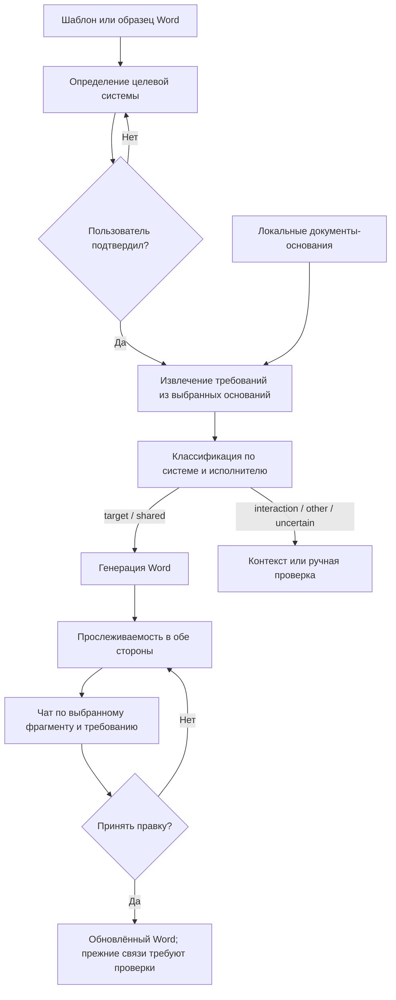

# MINT — карта кода и навигатор по разработке

> Назначение: быстро найти место изменения и соответствующие тесты. Это краткая карта, а не полный call graph и не спецификация реализации.
>
> Проверенная основа: коммит `8429e35fc2f6` ветки `main`, **до PR с обновлением этой карты**; 24 ноября 2026 г. Реальное поведение всегда определяется кодом.
>
> Перед **каждым релизом** карту следует сверить с актуальным `main`, проверить появившиеся и удалённые модули и зафиксировать проверенную базу; только после этого готовить выпуск. Проверка проводится разработчиком вручную, без дополнительных GitHub Actions.

> Экспериментальный этап V2: `mint/draft_registry.py:build_registry()` использует существующее извлечение, добавляет происхождение цитат и типизацию, но пока не вызывается из активной вкладки Word. Проверки — `tests/test_draft_registry.py`.

> Эксперимент V2: `mint/draft_function_analysis.py:analyze_functions()` группирует функциональные записи реестра и предлагает распределение ответственности со ссылками на существующее состояние. Сквозные требования и открытые вопросы остаются в отдельных списках. Это не доказательство смысловой корректности и пока не путь активного генератора. Тесты — `tests/test_draft_function_analysis.py`.

> Эксперимент V2: `mint/draft_derivation.py:derive_requirements()` формирует предварительные требования к целевому объекту по функциональной обязанности и предложенному распределению ответственности, проверяет ссылки, исполнителя, числовые значения и отдельно запрашивает смысловую оценку. `model_supported` — оценка модели, не экспертное согласование и не гарантия полноты. Тесты — `tests/test_draft_derivation.py`. Вкладка Word пока не использует этот путь.

> Эксперимент V2: `mint/draft_section_pilot.py:pilot_sections()` перечисляет безопасные пустые разделы, `create_section_pilot()` связывает разбор оригиналов, реестр, анализ функций, детализацию, проверку полноты по каждому исходному обязательству и существующую запись Word. Отчёт использует `build_traceability()`; полнота по неизвлечённым требованиям не доказана, сквозные ограничения ещё не распределены. Доступен из `mint/ui/tab_template_draft.py` по умолчанию как экспериментальный режим; прежний генератор сохранён временно. Прослеживаемость V2 только для чтения. Тесты — `tests/test_draft_section_pilot.py`.

> Отчёт V2: `mint/draft_pilot_report.py` и `mint/ui/draft_pilot_report_ui.py` показывают статусы всех извлечённых записей и формируют агрегированную диагностику по разрешённым полям без исходных текстов. Тесты — `tests/test_draft_pilot_report.py`. Реальная полнота не доказана.

> Прямые функциональные обязательства V2: явно названный целевой исполнитель и подтверждение моделью допускают дословную цитату без архитектурных ссылок, но с отдельной оценкой и проверкой полноты выбранного раздела. Производные требования по-прежнему требуют архитектурного основания. Тесты — `tests/test_draft_function_analysis.py`, `tests/test_draft_derivation.py`.

> V2: `draft_section_pilot._repair_need` выполняет не более одной попытки исправления на исходное обязательство с конкретным отрицательным заключением и ссылками на существующее устройство. Повторно использует `draft_derivation.validate_candidates`, оценку и проверку полноты. При отказе текст не записывается. Тест — `tests/test_draft_section_pilot.py`.

> V2: `draft_section_pilot.pilot_section_options` показывает распознанные заголовки и причины ограничения. Пилот поддерживает пустые разделы без готового абзаца и однозначные инструкции; повторно использует `_heading`, `_join_instruction_blocks`, `_safe_target` и `_fill_block` из `template_draft`. Обычный текст и сложные элементы не заменяются. Тест — `tests/test_draft_section_pilot.py`.

> V2: `draft_function_analysis` — подтверждённые псевдонимы целевой системы, обязанности целевой стороны обмена, сбалансированный подбор и ограниченное расширение контекста; `draft_derivation.assess_candidates` — независимые вердикты по пакетам до четырёх кандидатов; `draft_checkpoint.DraftStageCheckpoint` — локальное переиспользование валидированных решений типизации и группировки; `draft_pilot_report` — агрегаты причин отсева. Тесты в соответствующих `tests/test_draft_*.py`. Пилот по-прежнему формирует один раздел.

## 1. Точки входа и разделение ответственности

- `app.py` → `mint/ui/app.py:main()` — Streamlit, маршрутизация вкладок.
- `mint/ui/` — интерфейс и состояния сеанса; `mint/` без `ui/` — независимое ядро и правила доказательности.
- `mint/config.py`, `mint/limits.py`, `mint/version.py` — конфигурация, бюджет контекста, номер версии.
- `mint/services.py` — обращения к настроенным OpenAI-совместимым сервисам: LLM, эмбеддинги, необязательный реранкер.
- `eval_search.py`, `kb_stats.py` — отдельные диагностические CLI; `tests/run_all.py` — обычный офлайн-набор регрессионных тестов (без проверки схем).
- `.github/workflows/tests.yml`, `install.yml`, `docx-parity.yml`, `ui-preview.yml` — CI и установочные/интерфейсные проверки. `publish-release.yml` — публикация релиза и защита от размещения файлов с данными. Генерация и проверка схем **не запускаются в Actions**.

## 2. Основные пользовательские сценарии

| Сценарий | UI → ядро |
| --- | --- |
| Чат по документам | `mint/ui/tab_chat.py` → `mint/chat.py:answer_question()` |
| Консультант | `mint/ui/tab_consult.py` → `mint/consult.py:answer_consult()` |
| Аудит | `mint/ui/tab_audit.py` → `mint/audit.py:run_audit()`, `mint/deep_checks.py` |
| Контроль исправлений | `mint/ui/tab_review.py` → `mint/review.py:verify_remarks()` |
| Документ Word из шаблона или образца | `mint/ui/tab_template_draft.py` → `mint/draft_section_pilot.py:create_section_pilot()` (V2) или `mint/template_draft.py:create_draft()` (прежний режим) |
| Загрузка и переиндексация знаний | `mint/ui/sidebar.py` → `mint/kb.py`, `mint/parsing.py` |

### Формирование и доработка Word: последовательность

1. **Исходные данные.** `tab_template_draft.py` принимает DOCX (шаблон либо заполненный образец) и выбранные основания из локальной базы. Оригиналы должны быть доступны в `KB_DIR/sources/`.
2. **Цель документа.** `mint/document_context.py:infer_context()` предлагает целевую систему и контекст по шаблону; `mint/ui/draft_context_ui.py` требует явного подтверждения через `confirm_context()`. Основания могут охватывать другие платформы.
3. **Извлечение.** `mint/template_draft.py` разбирает основания, сохраняет точные цитаты, планирует разделы и таблицы, использует `mint/draft_checkpoint.py` для локальных контрольных точек и кэширования. Свободные потоки сразу получают новые запросы независимо от порядка завершения предыдущих; финальные цитаты и ID собираются строго в порядке оригиналов (ограниченный буфер).
4. **Применимость.** `mint/requirement_scope.py:classify()` различает `target`, `shared`, `interaction`, `other`, `uncertain`. Для обязанностей целевой системы допустимы только `target/shared`; отсутствие исполнителя не позволяет уверенно назначить обязанность.
5. **Формирование.** `create_draft()` заполняет пригодные для редактирования части Word, использует проверку цитат и допустимых ссылок (`mint/evidence.py`, функции `template_draft.py`), возвращает список проблем и выбранных оснований.
6. **Два направления прослеживаемости.** `mint/draft_traceability.py` строит «раздел Word → требования оснований» и «документ-основание → разделы Word»; `mint/ui/draft_traceability_ui.py` отображает обе стороны. Это учёт **извлечённых** требований и текстовых привязок, а не доказательство смысловой полноты.
7. **Правки в чате.** `mint/ui/document_edit_chat.py` и `mint/document_edit.py`: выбрать фрагмент, предложить правку с конкретным ID основания, сравнить diff, принять/отклонить, отменить доступную правку. `mark_stale_after_edits()` отмечает затронутые связи устаревшими; ограничение десяти снимков для отмены не сокращает журнал изменённых разделов.
8. **Диагностика прогона.** `template_draft.py:_measure_draft()` добавляет уникальный `run_id`, время/запросы этапов и `metrics.diagnostics`: счётчики кэша и ошибок извлечения, причины неполной классификации по ID. Эти данные содержат коды и числа, а не цитаты. Классификация и заполнение остаются прежними; [проект контракта V2](DRAFT_V2_CONTRACT.md) отделён от описания действующего кода.
9. **Экспертная оценка.** `mint/draft_review.py`, `mint/ui/draft_review_ui.py` сохраняют локальный ручной разбор. `mint/document_quality_benchmark.py` и синтетические фикстуры измеряют отдельные свойства доказательности; они не заменяют реальный контрольный прогон документа.

## 3. База знаний, поиск и HTTP

- `mint/parsing.py`, `mint/pdfparse.py` — DOCX/PDF/MD/TXT; `mint/kb.py` — parent/child, FAISS, BM25, сохранение оригиналов, переиндексация и профиль эмбеддингов.
- `mint/bm25.py`, `mint/glossary.py`, `mint/search.py`, `mint/passages.py` — лексический и векторный поиск, RRF, необязательный реранкер, сборка контекста; эти компоненты повторно используются сценариями, без отдельной базы для Word.
- `mint/chat.py`, `mint/citations.py` — формирование ответа и формальная проверка ссылок; `mint/evaluation.py` — оценка поиска и источников отдельно от ручной оценки содержания.
- Путь базы `KB_DIR` (обычно `~/knowledge_base`): `sources/` — оригиналы; `parent_store.json` — parent; `child_index.faiss` и `child_metadata.pkl` — child; `bm25_index.pkl` — слова; `manifest.json` — метаданные и совместимость эмбеддингов.
- `LOG_DIR` (обычно `~/mint_logs`): аудиты, отзывы, экспертные разборы Word, контрольные точки извлечения. Эти файлы могут содержать чувствительные цитаты и **не должны попадать в Git**.
- `.env`, `config.yaml` — адреса сервисов, токены и параметры; только локально. В репозитории допустимы публичные примеры `.env.example` и `config.example.yaml`. Доступ к модели — через `mint/services.py`, пользовательский интерфейс — Streamlit, а не отдельный REST API.
- Без совместимого профиля эмбеддингов dense-поиск не используется; лексический BM25 остаётся доступным, полная безопасная переиндексация — через механизмы `mint/kb.py`.

## 4. Навигатор: задача → исходники → тесты

| Задача | Исходники | Офлайн-проверки |
| --- | --- | --- |
| Извлечение, заполнение Word, таблицы | `template_draft.py`, `evidence.py` | `test_template_draft.py`, `test_draft_golden.py`, `test_draft_usable_word.py`, `test_evidence.py` |
| Базовая диагностика и ограничения старого генератора | `template_draft.py`, `requirement_scope.py` | `test_draft_v2_baseline.py`, `test_draft_parallel.py` |
| Кэш, возобновление, параллельное извлечение | `draft_checkpoint.py`, `template_draft.py` | `test_draft_checkpoint.py`, `test_draft_parallel.py` |
| Контекст целевой системы | `document_context.py`, `ui/draft_context_ui.py` | `test_document_context.py` |
| Исполнитель и применимость | `requirement_scope.py` | `test_requirement_scope.py` |
| Прослеживаемость, изменения Word и чат | `draft_traceability.py`, `document_edit.py`, соответствующие `ui/` | `test_draft_traceability.py`, `test_trace_to_chat.py`, `test_document_edit.py` |
| Ручной разбор и доказательность | `draft_review.py`, `document_quality_benchmark.py` | `test_draft_review.py`, `eval_document_quality.py` |
| Индексация и совместимость моделей | `kb.py`, `search.py`, `bm25.py` | `test_embedding_compatibility.py`, `test_app.py` |
| Чат, ссылки и ответ | `chat.py`, `citations.py`, `evaluation.py` | `test_app.py`, `test_answer_evaluation.py`, `test_eval.py` |
| Аудит, полнота и шум | `audit.py`, `deep_checks.py`, `audit_store.py` | `test_audit_quality.py`, `test_deep_checks.py`, `test_audit_noise.py`, `test_audit_completion.py` |
| Консультант, контроль исправлений | `consult.py`, `review.py` | `test_consult.py`, `test_app.py` |
| Переводы и промпты | `mint/i18n/`, `mint/prompts/` | `test_i18n.py`, `test_prompts.py` |
| UI, установка, сеть | `mint/ui/`, `install.sh`, `install.bat` | `test_streamlit_smoke.py`, `test_real_install.py`, `test_network.py` |
| Архитектурные схемы | `tools/diagrams/`, `docs/`, `docs/ru/` | **Вручную:** `python tests/test_diagrams.py`, `python tools/diagrams/check_release.py` |

Офлайн-тесты с имитациями моделей не доказывают качество генерации на реальных основаниях.

## 5. Схемы, документы и порядок перед релизом

- [Архитектурная схема (RU)](ru/MINT_architecture_preview.png), [инженерная схема (RU)](ru/MINT_engineering_preview.png). Редактируемые исходники и английские версии — в `docs/`, `docs/ru/`; **источник схем** — `tools/diagrams/build_architecture.py`, `build_engineering.py`, `en.py`.
- `tools/diagrams/README.md` содержит команды ручной генерации, `tests/test_diagrams.py` сверяет выходные файлы с генераторами, `tools/diagrams/check_release.py` вручную проверяет версию и подпись превью.
- **Перед каждым релизом:** (1) сравнить эту карту с кодом и обновить проверенный SHA; (2) проверить обе схемы и RU/EN версии, при необходимости локально пересобрать изображения и редактируемые файлы; (3) сверить `release/manifest.json` с `mint/version.py`; (4) запустить нужные проверки **вручную** и указать их результат в отчёте к PR; (5) убедиться в отсутствии секретов, рабочих файлов и цитат в публикации.
- **Без автоматической генерации и проверки схем или карты в GitHub Actions**. В `AGENTS.md` — краткие правила для AI; в `CONTRIBUTING.md` — процесс для всех разработчиков; `.github/workflows/publish-release.yml` проверяет безопасность публикуемых файлов, но не полноту архитектурной документации.
- Планы, задачи и карьерные заметки в этой публичной карте не хранятся. Следующая актуализация выполняется по diff от указанного выше базового коммита, а не требует заново читать весь репозиторий.
