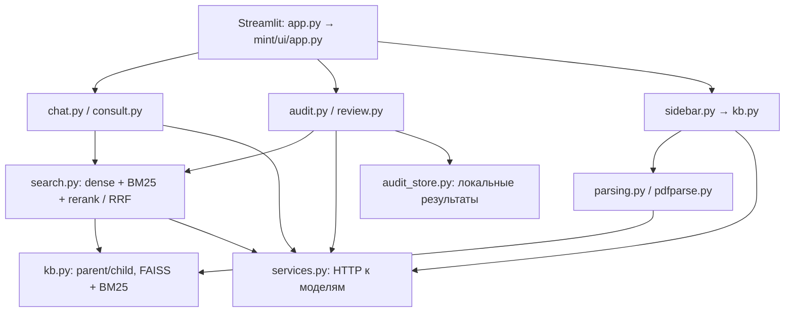

# MINT — краткая карта кода

> Назначение: навигатор для разработчика и AI («задача → код → тесты»), а не копия подробной архитектуры.
> Исходный код: [Sdorenskiy/mint](https://github.com/Sdorenskiy/mint).
> База текущих изменений: `843c550` (проверена совместимость эмбеддингов).
> Основа анализа: `main`, коммит [`7504be1`](https://github.com/Sdorenskiy/mint/commit/7504be1276e35f824f31419dfd7a8f97f0fb4ad8) (`7504be1276e35f824f31419dfd7a8f97f0fb4ad8`).
> Обновлено: 2026-11-14. Это статическая карта кода на указанном базовом коммите. Пути сверены с деревом репозитория; результаты проверок приложения указываются отдельно в PR/CI.

## 1. Точки входа и структура

- `app.py` → `mint/ui/app.py:main()` — запуск через `streamlit run app.py`.
- `mint/ui/` — интерфейс Streamlit, вкладки, боковая панель, настройки, отзывы.
- `mint/` (без `ui/`) — независимое от Streamlit ядро: сценарии, поиск, парсинг, база, API.
- `eval_search.py` — CLI для оценки поиска (hit@k, MRR, сравнение прогонов и кросс-проверка).
- `kb_stats.py` — локальная диагностика и сравнение баз знаний, без изменения файлов.
- `tests/run_all.py` — вход в набор автономных тестов; `tests/mock_server.py` имитирует API моделей.
- `.github/workflows/` — CI: `tests.yml`, `install.yml`, `docx-parity.yml`, `ui-preview.yml`.

Основные сценарии UI:
- Чат: `mint/ui/tab_chat.py:render_chat_tab()` → `mint/chat.py:answer_question()`.
- Консультант: `mint/ui/tab_consult.py:render_consult_tab()` → `mint/consult.py:answer_consult()`.
- Аудит: `mint/ui/tab_audit.py:render_audit_tab()` → `mint/audit.py:run_audit()`.
- Контроль исправлений: `mint/ui/tab_review.py:render_review_tab()` → `mint/review.py:verify_remarks()`.
- Загрузка документов: `mint/ui/sidebar.py:render_knowledge_base()` → `mint/kb.py:process_and_add_to_kb()`.

## 2. Карта связей (упрощённо)

Это навигационная схема, не полный call graph. Аудит использует поиск по базе знаний опционально.

## 3. Основные модули ядра

| Модуль | Зона ответственности |
| --- | --- |
| `mint/config.py`, `mint/limits.py` | Настройки, модели, лимиты и размеры контекста |
| `mint/services.py` | HTTP-вызовы LLM, эмбеддингов, реранкера; повторы, таймауты |
| `mint/parsing.py`, `mint/pdfparse.py` | Разбор DOCX/PDF/MD/TXT; преобразование в структуру/Markdown |
| `mint/kb.py` | Индексация, удаление, переиндексация, загрузка и согласованность индексов |
| `mint/bm25.py`, `mint/glossary.py` | Лексический поиск, нормализация, сокращения |
| `mint/search.py`, `mint/passages.py` | Гибридный поиск, RRF, выбор и объединение фрагментов |
| `mint/chat.py`, `mint/citations.py` | Чат по источникам, обработка истории, проверка ссылок |
| `mint/consult.py` | Консультант: план запроса, контекст, рекомендации |
| `mint/audit.py`, `mint/deep_checks.py` | Аудит, замечания, дополнительные проверки |
| `mint/review.py`, `mint/expert_review.py` | Контроль исправлений, экспертный разбор |
| `mint/audit_store.py`, `mint/feedback.py` | Локальное хранение аудитов и обратной связи |
| `mint/evaluation.py` | Измерение качества поиска и ответов |
| `mint/prompts/`, `mint/i18n/` | RU/EN промпты, профили и тексты интерфейса |

## 4. Локальные данные и API

MINT использует локальные файлы базы знаний, а не отдельный сервер PostgreSQL/SQL API.
Путь по умолчанию: `KB_DIR=~/knowledge_base` (можно переопределить).

| Файл/папка в KB_DIR | Содержимое |
| --- | --- |
| `sources/` | Оригиналы загруженных документов |
| `parent_store.json` | Родительские фрагменты с контекстом |
| `child_index.faiss` | Векторный индекс дочерних фрагментов (FAISS) |
| `child_metadata.pkl` | Метаданные дочерних фрагментов |
| `bm25_index.pkl` | Лексический индекс |
| `manifest.json` | Состояние и параметры базы |

- `LOG_DIR` (по умолчанию `~/mint_logs`): `audits/<id>/` — результаты аудитов, `feedback.jsonl` — отзывы; данные могут содержать фрагменты пользовательских документов.
- `.env` — адреса/API-ключи моделей, пути, секреты; `config.yaml` — параметры поведения. Эти файлы с реальными значениями **не** размещать в Git.
- Внешние API: `LLM_API_URL` → OpenAI-совместимый `/chat/completions`; `EMBED_API_URL` → embeddings; `RERANK_API_URL` → rerank (необязателен).
- `mint/services.py` выполняет HTTP-запросы через `requests`. Отдельного пользовательского REST API MINT в изученных точках входа нет; пользовательский интерфейс — Streamlit.
- При недоступном реранкере возможен поиск через FAISS+BM25; при недоступных эмбеддингах запроса — через BM25.

## 5. Навигатор: задача → место → тесты

| Задача | Сначала смотреть | Проверки |
| --- | --- | --- |
| Поиск, RRF, релевантность | `mint/search.py`, `mint/bm25.py`, `mint/passages.py` | `tests/test_app.py`, `tests/test_eval.py` |
| Загрузка и индексация | `mint/kb.py`, `mint/parsing.py` | `tests/test_app.py`, `tests/test_formats.py`, `tests/test_embedding_compatibility.py` |
| DOCX/PDF | `mint/parsing.py`, `mint/pdfparse.py` | `tests/test_formats.py`, `tests/test_real_install.py`, DOCX parity CI |
| Чат, цитаты | `mint/chat.py`, `mint/citations.py` | `tests/test_app.py`, `tests/test_llm_requests.py` |
| Консультант | `mint/consult.py`, `mint/ui/tab_consult.py` | `tests/test_consult.py` |
| Аудит, качество замечаний | `mint/audit.py`, `mint/deep_checks.py` | `tests/test_audit_quality.py`, `tests/test_audit_noise.py`, `tests/test_deep_checks.py`, `tests/test_audit_completion.py`, `tests/test_audit_typos.py` |
| Экспертный разбор, сохранение | `mint/expert_review.py`, `mint/audit_store.py` | `tests/test_expert_review.py` |
| Контроль исправлений | `mint/review.py`, `mint/ui/tab_review.py` | `tests/test_app.py` (проверить охват конкретной правки) |
| UI, тема, вкладки | `mint/ui/app.py`, `mint/ui/theme.py`, `mint/ui/tab_*.py` | `tests/test_streamlit_smoke.py`, UI preview CI |
| Промпты, переводы | `mint/prompts/`, `mint/i18n/en.py` | `tests/test_prompts.py`, `tests/test_i18n.py` |
| Настройки, API и сеть | `mint/config.py`, `mint/services.py`, `mint/limits.py` | `tests/test_env.py`, `tests/test_llm_requests.py`, `tests/test_stream_completion.py`, `tests/test_network.py` |
| Установка, безопасность окружения | `install.sh`, `install.bat`, `check_install.py` | `tests/test_real_install.py`, `tests/test_network.py`, install CI |
| Архитектурные схемы | `tools/diagrams/`, `docs/ru/` | `tests/test_diagrams.py` |

Тесты в таблице — **точки для начала проверки**, не гарантия полного покрытия. Для нового поведения добавлять регрессионные тесты и включать их в `tests/run_all.py`.

## 6. Подробные схемы и рабочий порядок

- [Общая схема Mint](https://github.com/Sdorenskiy/mint/blob/main/docs/ru/MINT_architecture_preview.png).
- [Инженерная схема Mint](https://github.com/Sdorenskiy/mint/blob/main/docs/ru/MINT_engineering_preview.png).
- Источник схем: `tools/diagrams/build_architecture.py` и `build_engineering.py`; актуальность проверяет `tests/test_diagrams.py`.
- Правила разработки: [CONTRIBUTING.md](../CONTRIBUTING.md); точка входа для AI: [AGENTS.md](../AGENTS.md).
- `ask_llm()` сохраняет строковый интерфейс: пустой ответ — ошибка `❌`, частичный — с маркером `TRUNCATED_MARKERS` (RU/EN). Это не заменяет проверку полноты итогового аудита.
- Результат аудита содержит `completion`: статус, число выполненных, ошибочных и пропущенных проверок. Сохранение результата сохраняет и полноту; старые аудиты без этих данных отображаются с предупреждением.
- `audit_typos` (по умолчанию `false`) отключает языковые задачи до ограничения бюджета и фильтрует распознанные опечатки до сведения/вывода; исходные ответы модели в диагностических логах сохраняются.
- Планы, приоритеты и статусы задач ведутся отдельно и здесь не дублируются. Основной экземпляр этой карты — `docs/CODE_MAP.md` в данном репозитории.

**При следующей задаче:** сначала прочитать этот файл; сравнить SHA выше с актуальным `mint/main`; при изменении SHA посмотреть diff и соответствующий код. Код — источник истины. При изменении архитектуры обновить карту и SHA, при обычном изменении — проверить необходимость обновления. Отдельно сообщать, какие тесты действительно запускались и что проверил CI.

- Профиль эмбеддингов хранится у документов в манифесте; `embeddings_compatible()` используется записью, поиском и статусом базы. Неизвестный/смешанный профиль отключает dense. `reindex_documents()` строит полную замену во временной папке под блокировкой; `_commit_kb()` подменяет файлы с откатом при ошибке публикации (это не журнал восстановления после аварийного завершения процесса).
