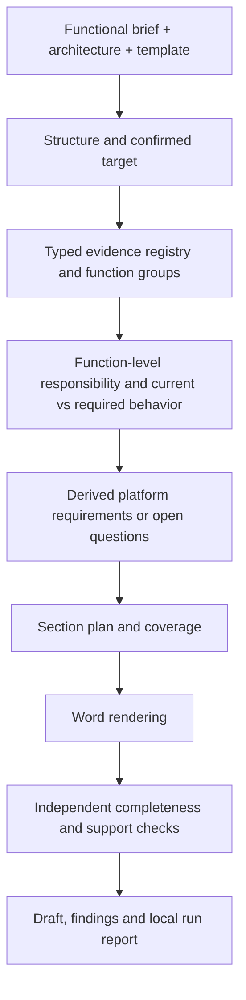

# Draft V2 — evidence-grounded generation: initial contract (proposed)

Status: **experimental design; not the current runtime behavior**. This PR records the baseline and adds local measurements; it does not replace the Word generator. All test material is fictional.

## Problem and non-goals

A functional brief may describe multiple systems. A platform-specific specification must refine those needs using approved architecture and responsibility boundaries, not merely copy quotations. A valid DOCX with an empty functional section is not a successful draft. A citation alone does not prove semantic coverage.

No organization-specific names, fixed section numbers, new server, multi-agent framework, second search engine or second evidence checker. Keep the existing parser, gateway, evidence utilities, DOCX safety, cache and traceability where compatible. Real documents and expert labels stay in the user's approved environment.

## Proposed stage boundaries

| Stage | Input → output | Invariant |
| --- | --- | --- |
| Parse | Source files and template → source spans, template sections | Preserve location and structure, including empty body sections; classify non-requirement material separately. |
| Extract | Source spans → evidence registry | Every factual item has a verified original citation. Preserve negations, conditions, quantities and exceptions. Consolidation never deletes provenance. |
| Scope | Registry + confirmed context → assignment per ID | Separate category (target/shared/interaction/other/uncertain) from processing status (classified/missing_response/invalid_response/request_failed). A missing reply is not a substantive uncertainty decision. |
| Analyze | Functional groups + targeted architecture evidence → platform requirements | Need evidence establishes why; architecture establishes responsibility/current behavior/constraints. Explicitly distinguish existing behavior, needed change and unresolved design decisions. No invented SLA, retries or component. |
| Plan | Platform requirements + template outline → section plan | Every applicable requirement has a destination or reason for exclusion. Include cross-cutting obligations and empty required sections; identify missing evidence before expensive rendering. |
| Render | Section plan → structured blocks and DOCX | Use deterministic Word writing wherever possible; preserve protected content, tables, styles and numbering. |
| Verify | Registry + plan + Word → issue codes, two-way links, readiness | Distinguish actual verified semantic coverage, citation/anchor only, omitted, conflicting, uncertain and technical failure. Open questions remain visible. |

Proposed IDs are stable within a recorded run, with source-version and span identity for cross-run matching. The registry is the single source for both directions of traceability, review, UI and export. Reuse the evidence functions and the existing document-quality benchmark; extend contracts only as needed by the vertical experiment. Do not create a parallel production pipeline indefinitely.

## Baseline and acceptance

Run `python tests/test_draft_v2_baseline.py` (included in `tests/run_all.py`). It exercises the current real drafting path with scripted replies on a fictional functional brief and architecture. Known limitations are explicitly printed as **KNOWN GAP** rather than hidden as successful model quality. `--strict` requires all listed target invariants and is deliberately not the CI mode while the legacy behavior is still installed. Once fixed, graduate the respective checks to mandatory assertions. Unexpected failures in exercised legacy invariants fail both modes.

The baseline covers noise, a missing classification response versus an explicit uncertainty, a target/external responsibility boundary, a derived functional obligation and a blank functional section. Expected facts are written independently of the fake replies. This is a contract/characterization exercise, not a semantic evaluation of an actual model.

The first experimental vertical scenario must be compared with a human-authored reference using locally held permitted data. Measure extraction precision/recall, scope errors, correct derived obligations, omissions, unsupported additions, structure and total time. Predeclare acceptance limits and hold out cases not used for tuning. If detailing a function fails on a limited case, do not expand to the full document.

Existing benchmark: `tests/eval_document_quality.py` (evidence/coverage), existing Word and scope regressions, and `mint/document_quality_benchmark.py`. Neither scripted benchmark proves quality on a real LLM.

## Run diagnostics

Use the existing metrics envelope: opaque per-run ID, extraction total/completed/cache hits/misses, chunks with failed requests or rejected quotations, existing per-stage LLM attempt count and summed elapsed request time, and total wall time. Request time can exceed wall time under concurrency. This PR does not yet implement complete classification-reason metrics or the diagnostic ZIP.

Future safe export uses an allowlist of counters and codes, not raw model prompts, filenames, source text or local configuration. Rebuild an anonymized structural DOCX from safe representations rather than exporting the actual draft; real semantic review is local. User-facing status is concise; aggregate warnings without hiding critical failures.

## Method references

- [NASA Systems Engineering Handbook: System Design Processes](https://www.nasa.gov/reference/4-0-system-design-processes/): allocation, decomposition and traceability.
- [Microsoft Document Intelligence layout model](https://learn.microsoft.com/en-us/azure/ai-services/document-intelligence/prebuilt/layout): structural understanding, not a cloud dependency.
- [OpenAI evaluation best practices](https://developers.openai.com/api/docs/guides/evaluation-best-practices): task-specific evaluation and human calibration.
- [Anthropic context engineering](https://www.anthropic.com/research/effective-context-engineering-for-ai-agents): targeted context rather than unbounded prompts.

The references motivate the design, not a claim of measured success.
