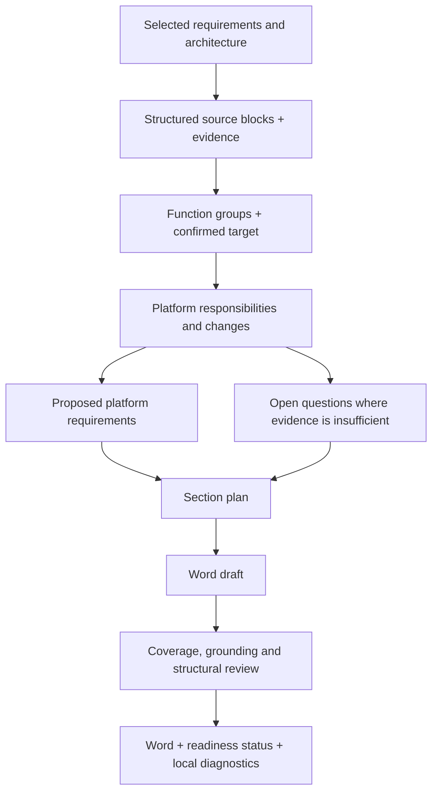

# Draft V2 — proposed contracts and pilot

Status: **proposed**, not the current drafting algorithm. Baseline: `ae2eb4f629829d3e4ffe89997cd083f745e9289e`. All examples below are fictional. The existing `create_draft` remains the active path.

## Goal

Turn a functional need into justified requirements for a confirmed target system using applicable architectural evidence; render a draft Word document. An architecture description is not itself an instruction to change a system. Do not fabricate implementation decisions, numerical limits or commitments. Use existing source parsing, evidence, retrieval, DOCX rendering and traceability primitives; avoid a parallel permanent implementation.

## Minimal stage contracts (to implement and validate in subsequent PRs)

| Stage | Input | Output and invariants |
| --- | --- | --- |
| Source parsing | Selected originals; source roles (need, architecture, normative context) | Source blocks with stable local references, location, hierarchy, exact text, role and revision. Distinguish TOC, headings, definitions, tables, and actual obligations. Keep context and original evidence. |
| Requirement registry | Source blocks, confirmed target and scope | Atomic source assertions; source refs, kind, subject, applicability and processing status. Preserve conditions, negation, quantities, alternate paths and cross-cutting constraints. Consolidate duplicate meaning only while keeping all evidence links. |
| Function analysis | Registry, applicable architecture blocks | Function groups, linked source IDs, current responsibility and behavior, needed changes, shared constraints and open questions. Architecture supports attribution, not an invented new obligation. |
| Derivation | Function group | Target-platform requirement candidates with distinct need refs and architecture/constraint refs; state explicit, justified derivation, or unresolved/proposal. Do not render unresolved proposals as approved obligations. |
| Section plan | Target requirements, structural template | Stable section IDs (including blank headings), intended content type and mapped requirements; missing information and intentional omissions. All applicable IDs must have a plan disposition. |
| Render | Plan, validated requirements, original DOCX | Word blocks/tables with stable associations to requirements, preserving protected content and formatting. Reuse existing safe writing functions. |
| Review | Source registry, derived requirements, output | Two-way checks: missing source needs and unsupported/incorrect output claims, as distinct checks. Open issues and readiness are not inferred from whether a DOCX was created. |

No fixed customer-specific names or section numbers in the core. ID uniqueness, evidence existence and schema completeness are deterministic checks; the semantic accuracy of the evidence and derivation requires evaluation. Incomplete classification response is a technical error, not proof of non-applicability. Bounded retry/splitting and checkpointing are future work, not part of this baseline.

## First synthetic vertical case

Use the fictional library kiosk inputs in `tests/test_draft_v2_baseline.py`. The task is book collection. The kiosk scans a code, the catalogue service owns reservation validity, and the archive service is outside the task. Cross-cutting failed-operation logging applies to participating services. The required functional section is empty in the input Word.

Expected acceptance of the future path, before inspecting actual model outputs:
- Identify book collection as the need; locate scanning as existing architectural context.
- Attribute responsibility correctly; do not assign catalogue decisions or archive retention to the kiosk.
- Preserve cross-cutting logging where applicable.
- Distinguish requirements from the contents line and current-state statements.
- Leave a missing timeout as an open question, not a made-up value.
- Produce a non-empty functional section when applicable requirements exist; retain other fixed Word text.
- Verify requirement IDs and source links in both directions; report any unresolved items.
- Use the existing golden/evidence suites for regressions. Add independent synthetic examples for unfamiliar templates and model errors. The scripted replies prove software invariants, not the semantic capability of any actual model.

## Baseline diagnostics implemented in this PR

The existing measured run returns a random `run_id`, `stages` (actual calls and summed request time), `total_seconds` (elapsed wall time), and `diagnostics`:

- `extraction`: total/completed fragments, cache hits/misses, failed fragments, fragments with rejected quotes, accepted records, duplicate quotes suppressed.
- `scope`: groups/failed groups, number of unexpected and duplicate model rows, counts and per-requirement codes. `classified`, `explicit_uncertain`, `missing_response`, `batch_error`, `invalid_category`, `missing_reason`, `missing_actor` are **processing** codes, not an assertion of semantic correctness. Duplicate rows are counted but the legacy last-valid-row decision is not changed in this PR. No raw model replies, quotes, paths or credentials in these diagnostic fields. LLM attempts may exceed cache misses due to retry; elapsed time differs from summed concurrent request time.

These fields are included by the existing local review metrics serialization. A safe one-click diagnostic archive, Word de-identification, changes to the UI, and versioning of intermediate data are **not** implemented yet. Existing review JSON files may contain private text; never export them as-is. A safe export must be generated from an explicit allowlist of structural identifiers and codes.

## Decision gate

Before expanding to all Word sections, compare a small vertical implementation against expert-approved functional requirements on synthetic and authorized local documents. Measure recall against a source-side reference, correct assignment, unsupported claims, coverage of derived obligations, formatting and end-to-end time. Keep existing tests passing; replace legacy characterization assertions with positive acceptance tests when retiring that path. Do not publish confidential examples, reports, or real model prompts. Do not claim quality improvement from CI alone.
