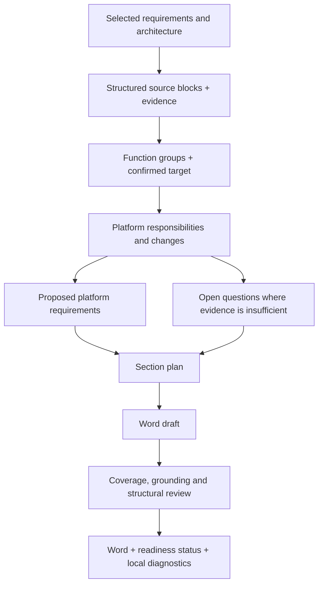

# Draft V2 — proposed contracts and pilot

Status: **proposed**, not the current drafting algorithm. Baseline: `ae2eb4f629829d3e4ffe89997cd083f745e9289e`. All examples below are fictional. The existing `create_draft` remains the active path.

## Goal

Turn a functional need into justified requirements for a confirmed target system using applicable architectural evidence; render a draft Word document. An architecture description is not itself an instruction to change a system. Do not fabricate implementation decisions, numerical limits or commitments. Use existing source parsing, evidence, retrieval, DOCX rendering and traceability primitives; avoid a parallel permanent implementation.

## Minimal stage contracts (to implement and validate in subsequent PRs)

| Stage | Input | Output and invariants |
| --- | --- | --- |
| Source parsing | Selected originals; source roles (need, architecture, normative context) | Source blocks with stable local references, location, hierarchy, exact text, role and revision. Distinguish TOC, headings, definitions, tables, and actual obligations. Keep context and original evidence. |
| Requirement registry | Source blocks, confirmed target and scope | Atomic source assertions; source refs, kind, subject, applicability and processing status. Preserve conditions, negation, quantities, alternate paths and cross-cutting constraints. Consolidate duplicate meaning only while keeping all evidence links. |
| Function analysis | Registry, applicable architecture blocks | Function groups, linked source IDs, current responsibility and behavior, needed changes, shared constraints and open questions. Architecture supports attribution, not an invented new obligation. |
| Derivation | Function group | Target-platform requirement candidates with distinct need refs and architecture/constraint refs; state explicit, justified derivation, or unresolved/proposal. Do not render unresolved proposals as approved obligations. |
| Section plan | Target requirements, structural template | Stable section IDs (including blank headings), intended content type and mapped requirements; missing information and intentional omissions. All applicable IDs must have a plan disposition. |
| Render | Plan, validated requirements, original DOCX | Word blocks/tables with stable associations to requirements, preserving protected content and formatting. Reuse existing safe writing functions. |
| Review | Source registry, derived requirements, output | Two-way checks: missing source needs and unsupported/incorrect output claims, as distinct checks. Open issues and readiness are not inferred from whether a DOCX was created. |

No fixed customer-specific names or section numbers in the core. ID uniqueness, evidence existence and schema completeness are deterministic checks; the semantic accuracy of the evidence and derivation requires evaluation. Incomplete classification response is a technical error, not proof of non-applicability. Bounded retry/splitting and checkpointing are future work, not part of this baseline.

## First synthetic vertical case

Use the fictional library kiosk inputs in `tests/test_draft_v2_baseline.py`. The task is book collection. The kiosk scans a code, the catalogue service owns reservation validity, and the archive service is outside the task. Cross-cutting failed-operation logging applies to participating services. The required functional section is empty in the input Word.

Expected acceptance of the future path, before inspecting actual model outputs:
- Identify book collection as the need; locate scanning as existing architectural context.
- Attribute responsibility correctly; do not assign catalogue decisions or archive retention to the kiosk.
- Preserve cross-cutting logging where applicable.
- Distinguish requirements from the contents line and current-state statements.
- Leave a missing timeout as an open question, not a made-up value.
- Produce a non-empty functional section when applicable requirements exist; retain other fixed Word text.
- Verify requirement IDs and source links in both directions; report any unresolved items.
- Use the existing golden/evidence suites for regressions. Add independent synthetic examples for unfamiliar templates and model errors. The scripted replies prove software invariants, not the semantic capability of any actual model.

## Baseline diagnostics implemented in this PR

The existing measured run returns a random `run_id`, `stages` (actual calls and summed request time), `total_seconds` (elapsed wall time), and `diagnostics`:

- `extraction`: total/completed fragments, cache hits/misses, failed fragments, fragments with rejected quotes, accepted records, duplicate quotes suppressed.
- `scope`: groups/failed groups, number of unexpected and duplicate model rows, counts and per-requirement codes. `classified`, `explicit_uncertain`, `missing_response`, `batch_error`, `invalid_category`, `missing_reason`, `missing_actor` are **processing** codes, not an assertion of semantic correctness. Duplicate rows are counted but the legacy last-valid-row decision is not changed in this PR. No raw model replies, quotes, paths or credentials in these diagnostic fields. LLM attempts may exceed cache misses due to retry; elapsed time differs from summed concurrent request time.

These fields are included by the existing local review metrics serialization. A safe one-click diagnostic archive, Word de-identification, changes to the UI, and versioning of intermediate data are **not** implemented yet. Existing review JSON files may contain private text; never export them as-is. A safe export must be generated from an explicit allowlist of structural identifiers and codes.

## Decision gate

Before expanding to all Word sections, compare a small vertical implementation against expert-approved functional requirements on synthetic and authorized local documents. Measure recall against a source-side reference, correct assignment, unsupported claims, coverage of derived obligations, formatting and end-to-end time. Keep existing tests passing; replace legacy characterization assertions with positive acceptance tests when retiring that path. Do not publish confidential examples, reports, or real model prompts. Do not claim quality improvement from CI alone.

## Registry implementation (experimental, phase 1)

`mint/draft_registry.py:build_registry` consumes selected parsed Markdown originals and a caller-supplied mapping of source roles (`need`, `architecture`, `normative`, `mixed`, `unspecified`). It reuses the actual legacy extraction and checkpoint path with optional provenance. Each record retains its source, section, quote, parsed-source SHA-256 revision and candidate fragment indices; these are Markdown locations, not original DOCX offsets. Deduplication remains exact within the same source and section; cross-source evidence remains separate. Clear contents entries are typed as non-requirements, not deleted. The generic type code current_state includes architectural facts and other existing-system descriptions; architecture remains a source role, not a type code. Other records are typed in bounded batches of at most 12 items; missing, malformed and duplicate responses remain uncertain with explicit processing codes. This typing is separate from applicability and not a semantic verification. The existing active Word path is unchanged. The next experimental phase must group functions, establish responsibility and derive target-platform obligations with distinct need and architecture evidence. No derivation or new Word rendering is claimed here.

## Functional analysis (experimental, phase 2)

`mint/draft_function_analysis.py:analyze_functions()` consumes the typed registry and confirmed target context. It groups functional obligations in bounded, batch-local groups using source IDs as anchors; a valid anchor maps to itself. All functional IDs receive an explicit grouping and allocation status, including missing or malformed replies. A group's current-state, constraint and question candidates reuse the existing selected-source ranking. Candidate IDs and a context-limit flag expose bounded retrieval. Cross-cutting requirements, open questions and untyped records remain visible globally; cross-cutting allocation and cross-batch group consolidation are not implemented yet. Per-obligation proposals use the existing applicability categories and require valid current-state IDs, a reason and a named actor; target proposals must name the confirmed target. Without current-state evidence the stage abstains unless an explicit target assignment is proposed by the model and the literal target name occurs in the source quotation. Mere mention is not proof. These checks validate structure and provenance, not the truth of the proposed assignment. No new obligations or Word content are emitted. Future derivation must check support and resolve gaps; group context and allocation proposals are not an approval to render text.

## Requirement derivation (experimental, phase 3)

`mint/draft_derivation.py:derive_requirements()` takes the typed registry, the function analysis and confirmed context. Each functional input gets a disposition. Target/shared responsibility proposals with valid current-state references enter derivation; a direct target obligation without such references may enter only as a verbatim quotation after independent assessment; external allocations remain proposals, not confirmed exclusions. A bounded reply contains one to six target-specific requirements or an open question. Each proposal carries a source-need ID, current-state IDs from its allocation and a justification, with explicit/derived mode. Reject wrong actors, unknown references, unsupported new numeric tokens (using the existing number guard), exact duplicate text and malformed replies. Cross-cutting constraints are retained as pending and cannot yet be cited as applicable constraints. A separate model call checks support, actor and invented decisions; `model_supported` means the model returned all three positive checks and a reason, not semantic proof or approval. The assessment is per candidate, not a complete coverage check of the source obligation or group. The experiment still needs allocation of cross-cutting obligations, group-level completeness review, original source-side recall evaluation and Word rendering. Calls and statuses are recorded in existing diagnostics. No change to the active Word generator.

## Empty-section vertical pilot (experimental)

`pilot_sections(template)` enumerates selectable simple empty leaf sections by body index. `create_section_pilot(template, cfg, sources, source_roles, context, section_index, progress=None, reset_extract_cache=False)` reads original sources using the existing shared loader and connects the registry, function analysis and derivation. It checks the entire candidate set for each functional need against that need, source evidence and selected heading, requiring explicit positive section-fit and coverage judgments. Negative, incomplete and oversized reviews remain pending. The existing Word writer inserts only model-covered candidates into an explicitly selected empty body section, consolidates identical text across needs and verifies the actual reopened DOCX paragraphs before building traceability via the existing module. No edits to surrounding sections, tables or title are intended. The result is always an unapproved draft with pending dispositions and diagnostics; linked current-state evidence is not a transferred obligation. Source-side recall, cross-cutting allocation, multi-section planning, actual internal-model quality, the user interface and a sanitized diagnostic export are still pending. The pilot cannot yet be invoked through the production Word tab. Synthetic scripted end-to-end tests do not establish actual model performance.

## Direct functional obligations

The pilot permits verbatim explicit target duties without architectural evidence only when the allocation proposes `direct: true`, the named actor matches the confirmed target, and the original quotation contains the literal target name. Separate assessment and section coverage review are still mandatory. Derived obligations retain architectural evidence checks. Cross-cutting and nonfunctional allocation remain pending.

## Bounded repair

A rejected candidate set with actionable semantic feedback or explicit coverage gap may be revised once using the existing derivation prompt and original allowed evidence. No new allocation or source IDs; direct duties without current-state refs, out-of-section proposals, technical errors and incomplete judgments are not retried. Every repaired candidate must pass the original structural and assessment gates and the whole-set section coverage review. Only a fully accepted set replaces the original proposals; failed repair remains pending. Aggregate counters are included in the sanitized export. This is not proof of model quality.

## Template selection compatibility

The one-section pilot is not restricted to a particular section number. It recognizes the shared Word heading detector, inherited outline levels and conservative manual numbered heading candidates. A normal paragraph is inserted when an empty section lacks a safe existing anchor. Full explicit instructions and explicitly labelled examples in an otherwise safe section are replaced only if approved candidates exist; the shared instruction validation and safe Word writer are reused. Fixed prose, complex body elements and protected titles remain blocked, with local reasons in the UI. Real templates still need local validation; no claim of full Word template compatibility or whole-document generation.

## Responsibility, evidence and execution (21.4.12)

Accept only full or explicitly confirmed parenthetical short names of the target; normalize actors to the confirmed name. Interaction proposals are eligible only for target-side duties, with validated source references and unchanged independent assessment and coverage gates. Reuse lexical ranking per obligation and group; fit serialized input to the model budget, with an initial evidence cap of 10,000 characters and one expansion up to 16,000 only for an explicit evidence gap and new source IDs. This is not a completeness guarantee. Assess at most four candidates in one bounded call, each with its own evidence and a separate ID/verdict. Missing/duplicate verdicts remain unverified. Do not repair when the reviewer explicitly reports insufficient evidence. Cache only validated typing/grouping maps locally using exact payload and model/prompt configuration fingerprints; force-reparse bypasses and clears the relevant cache entries. The diagnostic export contains only allowlisted status counts and numeric counters. No increase in parallel request limits. Full function decomposition, nonfunctional allocation and whole-document generation remain future work.

## Compact results and combined analysis export (21.4.13)

The results view presents counts, duration, Word download and one `mint_draft_analysis.json` download. Detailed issues, source dispositions, traceability, timings and local expert review are collapsed. Blocking failures remain visible. The combined file contains allowlisted numeric generation/traceability diagnostics and expert summary only if the saved review matches the exact current generation run and inputs; otherwise `expert_review` is null. Historical review-only summaries remain available when no current draft is active. The package does not contain Word, requirement text, filenames, model names, raw metadata, identifiers or fingerprints. For legacy edited Word, traceability in this package describes the original generation. This does not establish semantic coverage. No model calls added.

## Checkpoint 1: evidence-first registry (21.4.14, experimental)

Default V2 option is registry-only; explicitly disable it to run the preceding Word pilot. Preparation reads originals, retains full heading paths, classifies sections and proposes a bounded evidence-linked profile. User selects and confirms functions. Focused extraction uses the existing registry and private checkpoints; every original fragment is screened, not just top-k. Hybrid search reuses search_parent_child with pre-ranking allowlist, source-hash filter and original-span matching. Older manifests have no hashes, so hits are hints and exact original spans are used; stale known revisions are excluded; original-only lexical fallback is explicit. No automatic reindex. All profile facts are hypotheses until reviewed. Target decisions distinguish external, already supported, new/change, explicit duty and unknown. Independent model checks and global grouping by function ID or exact new-function label precede group-level derivation and coverage; oversized groups have bounded sub-batches. Metrics retain source values/units/subject/conditions and current/target level. Registry review and single safe JSON export are local; no Word is written. No raw originals or evidence text in diagnostic export. Current limitations: semantic merging of variant new-function labels and performance tuning remain later work; user correction is through context and profile reselection; model checks do not prove completeness. Real checkpoint-1 gate requires local expert comparison.

## Explicit cross-references and progress (21.4.15, experimental)

V2 registry builds a deterministic map from selected original fragments and numbered heading paths, captioned Markdown tables and appendices. Word metadata adds standard decimal numbering and heading bookmarks / supported REF and hyperlink fields. Only uniquely matched headings/addresses are usable; complex numbering overrides, nonstandard numbering, non-heading bookmarks, ambiguous table rows and unresolved external document names are not guessed. Named external documents must be among selected sources. Sibling ranges are bounded. Traversal keeps original span IDs and paths, avoids cycles, caps depth/spans/context and records missing references. Extraction uses linked original text for comprehension but quotations must come from the current fragment; selected-source revision changes invalidate focused extraction checkpoints. Allocation prioritizes linked evidence, retains unresolved gaps, and independent review and derivation preserve responsibility. The separate aggregate export allowlists reference statuses. This is not full OOXML field evaluation, semantic link discovery, or evidence that all references were resolved on real inputs. Old Word/legacy generation behavior is unchanged apart from progress.

A shared callback protocol uses *_total and *_done events for completed units, not started LLM requests. Per-stage wall-clock ETA is approximate; cache hits suppress extraction ETA, and no future whole-run estimate is fabricated. Updates are throttled except start/completion. Repeated nested repair assessments display the current repair sub-operation. No extra LLM requests or search queries are required for progress; linked context increases input tokens and may alter the quality/cost of V2 analysis.

## Function-directed supplementary retrieval (21.4.16, experimental)

The original full scan remains authoritative for candidate discovery, not semantic validity. The same scoped hybrid search and lexical fallback query six groups of general system/interface characteristics for each confirmed function. Original fragments and explicit reference expansion are bounded by the existing context budget. The model returns exact contiguous quotes, original span IDs and facet codes. Valid supplemental quotes are appended before existing typing; exact duplicates merge provenance, existing IDs and quotes are not deleted. No search hit becomes an obligation without attribution and review. Dossier evidence may fill unused per-record context and is explicitly passed to subsequent review/derivation/coverage when selected; unresolved and context-limited facets remain visible. This does not certify exhaustive retrieval, applicability, or semantic preservation of all earlier proposals. Unconfirmed new functions still use the full scan.

Verification uses batches of at most four independently validated records, bounded by context budget. Only fully valid positive batches are cached under exact model/prompt/payload identity. Cache and retrieval counters, structured validation causes and dossier status counts are aggregate-only diagnostics. New candidate quality gates require standalone completeness, unambiguous wording and verifiability in addition to existing checks. Exact duplicates within a group are consolidated with links preserved. The legacy Word and chat/audit paths retain their previous semantic gates.

Full private local XLSX includes proposed and unreflected records, source provenance, trace links, performance metrics, function characteristics, linked sections and questions. All user-sourced cell values are strings, not formulas. The separate baseline JSON is also private; exact source/section/quote keys and accepted-proposal keys compare runs only with the same source revision hashes, roles, context and selected function names. Exact mismatches are expert review candidates, not automatically semantic regressions. Separate sanitized diagnostics remain unchanged in privacy contract.

Methodological anchors (not a claim of certification): ISO/IEC/IEEE 29148 requirements engineering; NASA Systems Engineering Handbook 4.0 system design and 6.2 requirements management; NASA Appendix L interface requirements outline; INCOSE Guide to Writing Requirements; hybrid retrieval and staged evaluations. Actual model quality and wall-clock improvement require an in-contour same-input/same-profile evaluation. No release or Word readiness claim.

## Optional pre-decomposition review (21.4.17)

The registry-only path is split at the existing independent allocation verification boundary. Collecting produces the same source registry, decisions and function dossiers plus bounded draft summaries of verified change candidates. Each summary must cite every input need ID, only allowed supporting IDs, and source-backed numbers. On invalid or incomplete responses, original quotations remain available. This is not a semantic proof of summary correctness and does not replace the original evidence. Unresolved allocation and external/current-state records remain visible. Default expert mode pauses; automatic mode continues with the same core functions without requesting review summaries. A later switch to expert mode can review original quotes from the already collected snapshot. The review can include/exclude individual verified needs by function, and supply bounded expert guidance separately from source evidence. Excluded needs remain in dispositions and the original graph, but their record IDs are filtered out of derivation and coverage evidence references. This is record-level scope, not removal of overlapping original passages. Guidance is not authority for new duties or facts. Derivation and independent assessment/coverage still use original evidence and require their existing gates. Intermediate data are session-local (not a restart-resumable checkpoint); existing extraction/verification caches are unchanged. Source revisions and collection identity are revalidated on resume, and source revisions again after derivation. No re-extraction, retrieval or allocation on decomposition. Compute time sums both stages and excludes waiting for user input. The private XLSX shows summaries, scope and notes; sanitized JSON includes phase and allowed numeric counts only. Baseline identity distinguishes deliberate exclusions/guidance. Word generation and real-model accuracy remain unverified.

## Guided registry UI (21.4.18)

The default V2 registry UI displays one active stage: materials, context and functions, collected needs, or decomposed registry. The fifth Word stage is explicitly unavailable; existing Word modes remain in advanced settings. Material snapshots (including uploaded template bytes), confirmed context, profile selection and draft expert selection/comments live only in the current session. Navigation does not trigger LLM calls; unchanged inputs and identical confirmed scope reuse the existing collection and result. Confirmed changes to materials or context invalidate dependent results; profile changes require explicit re-collection and scope changes require only decomposition. Source metadata changes and collection identity changes invalidate stale downstream state. The existing core original-revision checks still apply. Results are paginated/filterable, and local Excel, baseline comparison and sanitized diagnostics are available separately. No change to extraction, RAG, prompts, verification or Word generation semantics.

## Scoped wiki context pilot (21.4.19)

Original bases (A) and optional informational references (B) have disjoint explicitly selected document scopes. B is limited to eight documents, parsed separately, retrieved with the existing hybrid/lexical mechanism and mapped to original spans with BF IDs. The existing full A extraction and A-only function dossier supplement remain unchanged in structure; B cannot enter the original registry or become a need/constraint ID. A-only focus and evidence budget take priority, B hints and excerpts fit into leftover bounded allocation context. B excerpts are marked reference_context in model evidence, not independent authority. Numeric targets and generated numbers must be supported by A, not solely B. Semantic applicability and currency still require model and expert verification. Selected B documents and original revision hashes participate in collection identity and local baseline comparison; changed bytes invalidate the review. No separate index or full-wiki scan. Discovery distinguishes no candidates, incomplete model response, invalid structure/references, no functions, partial and found. Users may continue with zero selected functions; this retains the original full scan but lacks function-directed supplementation. A suggestions may include future functions; B suggestions are intended to describe existing functions, not independently verified facts. The section map is diagnostic only; repeat collection is offered after a matching result. The local workbook includes B excerpts; sanitized diagnostics expose only fixed counts. Changing B currently invalidates dependent session results (existing exact extraction caches may be reused). Normative checks, unrestricted wiki search, independent as-is currency verification, and Word integration remain future work. Real-model completeness and performance are not established by fixture tests.
