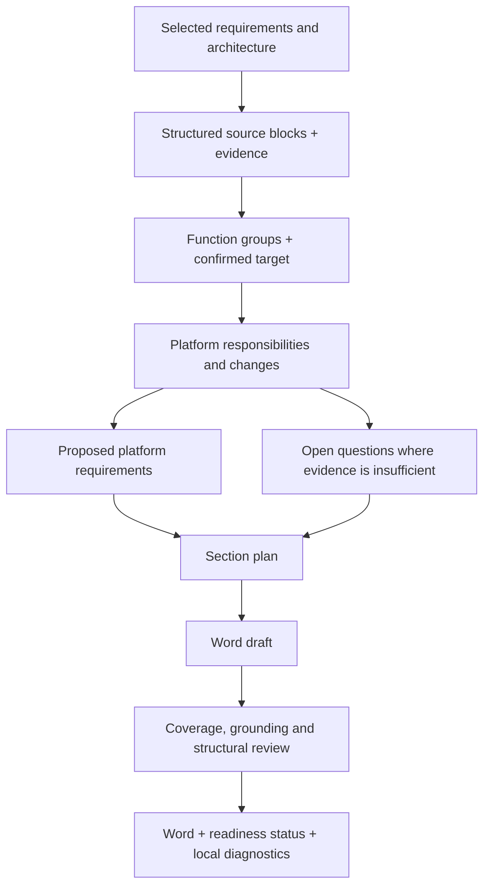

# Draft V2 — proposed contracts and pilot

Status: **proposed**, not the current drafting algorithm. Baseline: `ae2eb4f629829d3e4ffe89997cd083f745e9289e`. All examples below are fictional. The existing `create_draft` remains the active path.

## Goal

Turn a functional need into justified requirements for a confirmed target system using applicable architectural evidence; render a draft Word document. An architecture description is not itself an instruction to change a system. Do not fabricate implementation decisions, numerical limits or commitments. Use existing source parsing, evidence, retrieval, DOCX rendering and traceability primitives; avoid a parallel permanent implementation.

## Minimal stage contracts (to implement and validate in subsequent PRs)

| Stage | Input | Output and invariants |
| --- | --- | --- |
| Source parsing | Selected originals; source roles (need, architecture, normative context) | Source blocks with stable local references, location, hierarchy, exact text, role and revision. Distinguish TOC, headings, definitions, tables, and actual obligations. Keep context and original evidence. |
| Requirement registry | Source blocks, confirmed target and scope | Atomic source assertions; source refs, kind, subject, applicability and processing status. Preserve conditions, negation, quantities, alternate paths and cross-cutting constraints. Consolidate duplicate meaning only while keeping all evidence links. |
| Function analysis | Registry, applicable architecture blocks | Function groups, linked source IDs, current responsibility and behavior, needed changes, shared constraints and open questions. Architecture supports attribution, not an invented new obligation. |
| Derivation | Function group | Target-platform requirement candidates with distinct need refs and architecture/constraint refs; state explicit, justified derivation, or unresolved/proposal. Do not render unresolved proposals as approved obligations. |
| Section plan | Target requirements, structural template | Stable section IDs (including blank headings), intended content type and mapped requirements; missing information and intentional omissions. All applicable IDs must have a plan disposition. |
| Render | Plan, validated requirements, original DOCX | Word blocks/tables with stable associations to requirements, preserving protected content and formatting. Reuse existing safe writing functions. |
| Review | Source registry, derived requirements, output | Two-way checks: missing source needs and unsupported/incorrect output claims, as distinct checks. Open issues and readiness are not inferred from whether a DOCX was created. |

No fixed customer-specific names or section numbers in the core. ID uniqueness, evidence existence and schema completeness are deterministic checks; the semantic accuracy of the evidence and derivation requires evaluation. Incomplete classification response is a technical error, not proof of non-applicability. Bounded retry/splitting and checkpointing are future work, not part of this baseline.

## First synthetic vertical case

Use the fictional library kiosk inputs in `tests/test_draft_v2_baseline.py`. The task is book collection. The kiosk scans a code, the catalogue service owns reservation validity, and the archive service is outside the task. Cross-cutting failed-operation logging applies to participating services. The required functional section is empty in the input Word.

Expected acceptance of the future path, before inspecting actual model outputs:
- Identify book collection as the need; locate scanning as existing architectural context.
- Attribute responsibility correctly; do not assign catalogue decisions or archive retention to the kiosk.
- Preserve cross-cutting logging where applicable.
- Distinguish requirements from the contents line and current-state statements.
- Leave a missing timeout as an open question, not a made-up value.
- Produce a non-empty functional section when applicable requirements exist; retain other fixed Word text.
- Verify requirement IDs and source links in both directions; report any unresolved items.
- Use the existing golden/evidence suites for regressions. Add independent synthetic examples for unfamiliar templates and model errors. The scripted replies prove software invariants, not the semantic capability of any actual model.

## Baseline diagnostics implemented in this PR

The existing measured run returns a random `run_id`, `stages` (actual calls and summed request time), `total_seconds` (elapsed wall time), and `diagnostics`:

- `extraction`: total/completed fragments, cache hits/misses, failed fragments, fragments with rejected quotes, accepted records, duplicate quotes suppressed.
- `scope`: groups/failed groups, number of unexpected and duplicate model rows, counts and per-requirement codes. `classified`, `explicit_uncertain`, `missing_response`, `batch_error`, `invalid_category`, `missing_reason`, `missing_actor` are **processing** codes, not an assertion of semantic correctness. Duplicate rows are counted but the legacy last-valid-row decision is not changed in this PR. No raw model replies, quotes, paths or credentials in these diagnostic fields. LLM attempts may exceed cache misses due to retry; elapsed time differs from summed concurrent request time.

These fields are included by the existing local review metrics serialization. A safe one-click diagnostic archive, Word de-identification, changes to the UI, and versioning of intermediate data are **not** implemented yet. Existing review JSON files may contain private text; never export them as-is. A safe export must be generated from an explicit allowlist of structural identifiers and codes.

## Decision gate

Before expanding to all Word sections, compare a small vertical implementation against expert-approved functional requirements on synthetic and authorized local documents. Measure recall against a source-side reference, correct assignment, unsupported claims, coverage of derived obligations, formatting and end-to-end time. Keep existing tests passing; replace legacy characterization assertions with positive acceptance tests when retiring that path. Do not publish confidential examples, reports, or real model prompts. Do not claim quality improvement from CI alone.

## Registry implementation (experimental, phase 1)

`mint/draft_registry.py:build_registry` consumes selected parsed Markdown originals and a caller-supplied mapping of source roles (`need`, `architecture`, `normative`, `mixed`, `unspecified`). It reuses the actual legacy extraction and checkpoint path with optional provenance. Each record retains its source, section, quote, parsed-source SHA-256 revision and candidate fragment indices; these are Markdown locations, not original DOCX offsets. Deduplication remains exact within the same source and section; cross-source evidence remains separate. Clear contents entries are typed as non-requirements, not deleted. The generic type code current_state includes architectural facts and other existing-system descriptions; architecture remains a source role, not a type code. Other records are typed in bounded batches of at most 12 items; missing, malformed and duplicate responses remain uncertain with explicit processing codes. This typing is separate from applicability and not a semantic verification. The existing active Word path is unchanged. The next experimental phase must group functions, establish responsibility and derive target-platform obligations with distinct need and architecture evidence. No derivation or new Word rendering is claimed here.

## Functional analysis (experimental, phase 2)

`mint/draft_function_analysis.py:analyze_functions()` consumes the typed registry and confirmed target context. It groups functional obligations in bounded, batch-local groups using source IDs as anchors; a valid anchor maps to itself. All functional IDs receive an explicit grouping and allocation status, including missing or malformed replies. A group's current-state, constraint and question candidates reuse the existing selected-source ranking. Candidate IDs and a context-limit flag expose bounded retrieval. Cross-cutting requirements, open questions and untyped records remain visible globally; cross-cutting allocation and cross-batch group consolidation are not implemented yet. Per-obligation proposals use the existing applicability categories and require valid current-state IDs, a reason and a named actor; target proposals must name the confirmed target. Without current-state evidence the stage abstains unless an explicit target assignment is proposed by the model and the literal target name occurs in the source quotation. Mere mention is not proof. These checks validate structure and provenance, not the truth of the proposed assignment. No new obligations or Word content are emitted. Future derivation must check support and resolve gaps; group context and allocation proposals are not an approval to render text.

## Requirement derivation (experimental, phase 3)

`mint/draft_derivation.py:derive_requirements()` takes the typed registry, the function analysis and confirmed context. Each functional input gets a disposition. Target/shared responsibility proposals with valid current-state references enter derivation; a direct target obligation without such references may enter only as a verbatim quotation after independent assessment; external allocations remain proposals, not confirmed exclusions. A bounded reply contains one to six target-specific requirements or an open question. Each proposal carries a source-need ID, current-state IDs from its allocation and a justification, with explicit/derived mode. Reject wrong actors, unknown references, unsupported new numeric tokens (using the existing number guard), exact duplicate text and malformed replies. Cross-cutting constraints are retained as pending and cannot yet be cited as applicable constraints. A separate model call checks support, actor and invented decisions; `model_supported` means the model returned all three positive checks and a reason, not semantic proof or approval. The assessment is per candidate, not a complete coverage check of the source obligation or group. The experiment still needs allocation of cross-cutting obligations, group-level completeness review, original source-side recall evaluation and Word rendering. Calls and statuses are recorded in existing diagnostics. No change to the active Word generator.

## Empty-section vertical pilot (experimental)

`pilot_sections(template)` enumerates selectable simple empty leaf sections by body index. `create_section_pilot(template, cfg, sources, source_roles, context, section_index, progress=None, reset_extract_cache=False)` reads original sources using the existing shared loader and connects the registry, function analysis and derivation. It checks the entire candidate set for each functional need against that need, source evidence and selected heading, requiring explicit positive section-fit and coverage judgments. Negative, incomplete and oversized reviews remain pending. The existing Word writer inserts only model-covered candidates into an explicitly selected empty body section, consolidates identical text across needs and verifies the actual reopened DOCX paragraphs before building traceability via the existing module. No edits to surrounding sections, tables or title are intended. The result is always an unapproved draft with pending dispositions and diagnostics; linked current-state evidence is not a transferred obligation. Source-side recall, cross-cutting allocation, multi-section planning, actual internal-model quality, the user interface and a sanitized diagnostic export are still pending. The pilot cannot yet be invoked through the production Word tab. Synthetic scripted end-to-end tests do not establish actual model performance.

## Direct functional obligations

The pilot permits verbatim explicit target duties without architectural evidence only when the allocation proposes `direct: true`, the named actor matches the confirmed target, and the original quotation contains the literal target name. Separate assessment and section coverage review are still mandatory. Derived obligations retain architectural evidence checks. Cross-cutting and nonfunctional allocation remain pending.

## Bounded repair

A rejected candidate set with actionable semantic feedback or explicit coverage gap may be revised once using the existing derivation prompt and original allowed evidence. No new allocation or source IDs; direct duties without current-state refs, out-of-section proposals, technical errors and incomplete judgments are not retried. Every repaired candidate must pass the original structural and assessment gates and the whole-set section coverage review. Only a fully accepted set replaces the original proposals; failed repair remains pending. Aggregate counters are included in the sanitized export. This is not proof of model quality.
